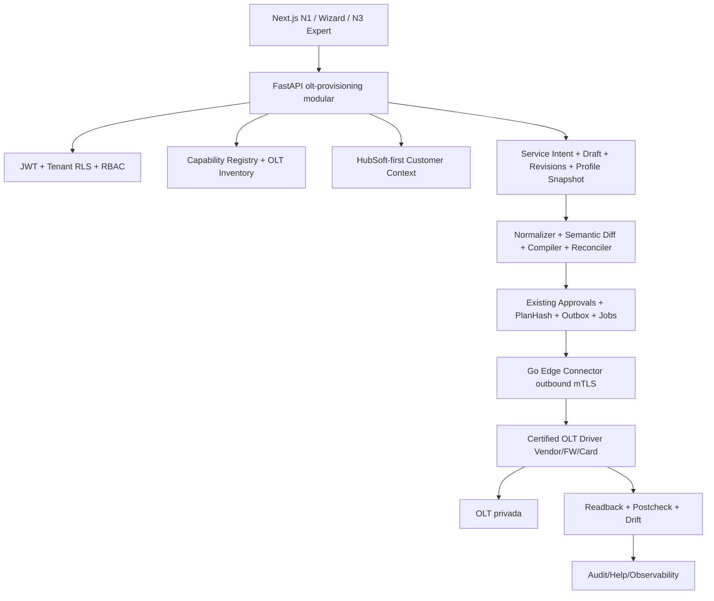

# Arquitetura unificada — OLT Provisioning & Profile Studio

- **Read path**: Edge coleta Discovery/Profile Inventory/Snapshot somente leitura, com timestamp, versão exata, evidência, qualidade. API persiste observações isoladas tenant/OLT.
- **Edit path**: clone do snapshot não altera OLT. Campos editados são modelo canônico validado e `vendor_extensions` sob JSON Schema allowlist.
- **Plan path**: normalizar → comparar semanticamente → resolver binding por OLT → simular ações tipadas → registrar hash e TTL. `preview` não grava na OLT.
- **Write path**: somente após aprovação humana independente, certificação de driver+escopo e checagem fingerprint/reference_count/OLT firmware/cartão, Edge mTLS, locks e readback.
- **No generic CLI execution**: renderização controlada e, opcionalmente, texto apenas de visualização para N3. Import de output legado é entrada não confiável.
- **Postcheck**: registro ONU + profile match + service-port/VLAN + status e, quando disponível, BNG/GenieACS/USP. Evidência limitada marcada `PARTIAL`/`UNKNOWN` e não `VERIFIED`.
- **Resiliência**: módulos independentes observáveis, read-only disponível quando ERP falha, queue/backoff com idempotência, recuperação explícita de estados incertos.
- **Governança**: nenhuma migração automática de ONUs quando um template é alterado; revisão lógica publicada ≠ deploy físico.
