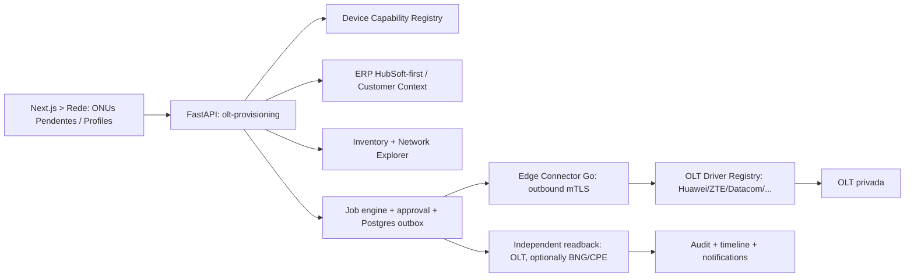

# Arquitetura aditiva v2.5

- **Não adicionar um novo ACS nem backend monolítico paralelo**. OLT driver no Edge, com interfaces tipadas `discover_unregistered()`, `read_profile_inventory()`, `compile_intent()`, `prepare_plan()`, `apply_plan()`, `verify()`. Sem passthrough shell/CLI livre.
- Driver capabilities indexado por `vendor/product/firmware/mainboard/pon_card/technology/feature/action`. Status `unknown`, `read_verified`, `lab_certified_write`, `blocked`. Inicial: Huawei MA5608T versão R015 específica como piloto a confirmar em laboratório; não estender homologação ao MA5800 automaticamente.
- Cross-vendor: Canonical Service Intent + compilador renderer por vendor; PHY equivalentes **não implicam sintaxe ou QoS idênticos**.
- OLT profiles do tipo `logical_template` (catálogo), `olt_profile_binding` (ID/nome/existing fingerprint por OLT), `provisioning_plan` (intent+diff+snapshot+approval+TTL), `provisioning_job`, `onu_discovery_observations`, `onu_activation_binding`.
- Tenant-scoping em todos. Chave ONU `tenant_id/olt_id/pon_locator/serial` para observações; identificação física global deduzida com evidências, sem união cross-tenant por SN.
- Esperar/capturar auto-find; **habilitar auto-find é operação separada** sujeita a aprovação, pois alguns equipamentos o deixam desligado.
- Reconciliar evento da descoberta (`ONU_UNREGISTERED`) com observações periódicas; priorizar fontes OLT. `STALE` separado de `OFFLINE`; dedup por SN+OLT/PON e tempo.
- ONU autorizar deve **verificar leitura de identificação imediatamente antes de escrever** (TOCTOU), locks por `(tenant,olt,pon,serial)` e `(tenant,olt,profile-scope)`; idem para migração.
- Profiles criados em `staging` lógico e publicados apenas após aprovação. Em OLT sem transação: saga/step recorder com estado `PARTIAL` e correção manual. Nunca excluir perfil compartilhado por rollback cego.
- Plano contém fingerprint de configuração existente, template revision, firmware/card revision e hash de diff; revalidar na borda antes do commit.
- Idempotência em jobs, ordens e associação; não confiar só em retornos CLI. Verificar a configuração ao final, associação PON, match/config state e serviço dentro da telemetria disponível.
- Não bloquear operações de leitura caso HubSoft esteja fora: mostrar associação `unavailable`, restringir escrita pela política.

## Eventos sugeridos
`olt.onu.unregistered.observed.v1`, `olt.profile.intent.published.v1`, `olt.profile.deployment.requested.v1`, `olt.profile.drift.detected.v1`, `olt.onu.authorization.requested.v1`, `olt.onu.authorization.verified.v1`, `olt.onu.authorization.uncertain.v1`; reutilizar outbox/NATS e payloads sem segredos.

## Observabilidade
`olt_discovery_age_seconds`, `olt_unregistered_onus`, `olt_profile_drift_total`, `olt_activation_jobs_by_state`, `olt_activation_verified_total`, `olt_driver_read_failures`, `olt_driver_write_blocks`, `olt_provisioning_duration_seconds`. Módulo opcional falhar não derruba API principal.
