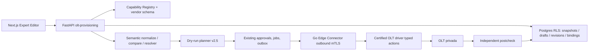

# Arquitetura aditiva — Expert Editor

## Entidades aditivas (ou reutilização de equivalentes)
- `olt_profile_snapshot`: `tenant_id, id, olt_id, vendor, product, firmware, pon_card, technology, native_profile_type, native_id/name, observed_at, freshness, completeness, origin, normalized_json, canonical_fingerprint, native_fingerprint, reference_count [nullable], raw_config_redacted [nullable]`. **Imutável**; readback cria novo snapshot.
- `expert_profile_draft`: `tenant_id, id, source_snapshot_id?, source_template_revision_id?, status, schema_version, desired_json, patch_history, author_id, row_version, created_at`. Draft mutável em optimistic concurrency; publicar nova revisão imutável.
- `expert_profile_revision`: `tenant_id, id, logical_template_id, rev, canonical_json, hash, author, reviewed_by, changelog, published_at`. Índice único `(tenant,logical_template,rev)`.
- `olt_profile_binding` v2.5 enriquecido: `tenant_id,olt_id, logical_revision_id, native_profile_id, native_fingerprint, mapping_status, last_checked_at`.
- `olt_profile_reference`: `tenant_id,olt_id, native_profile_id, onu_id?, service_port_id?, observed_at` sempre com contagem/qualidade.
- `expert_comparison`: `tenant_id,id,left_snapshot/ref,right_ref,semantic_diff,driver_version,created_at,ttl,source_hashes`; invalidar por mudança do alvo.

## Normalização
Driver recolhe dados vendor-native **somente leitura**, com provenance; normalizador produz representação comum + extensões tipadas de vendor. Propriedades não observáveis são `not_observable`, **não equivalentes**. Fingerprint deriva de serialização canônica segura, sem timestamps e sem identificadores OLT-locais irrelevantes. Não afirmar equivalência entre QoS, GEM, DBA de fabricantes sem regra explícita.

## Controle e sincronização
- Optimistic locking de draft por `ETag`/`If-Match`; lock distribuído `tenant+olt+native_profile` para planos de escrita; idempotência por job; separar plano de profile e migração.
- **TOCTOU**: antes de enviar ações, reler references, fingerprint real, firmware/card, estado, janela e approval hash. Qualquer divergência bloqueia execução e gera novo preview.
- Certificação write por `vendor/product/firmware/card/feature/action` no Capability Registry.
- Estado desconhecido pós-aplicação NÃO representa sucesso; sem retry cego para operações não idempotentes.
- Nunca incluir raw CLI, credenciais ou SN sensível nos eventos; snippets read-only redigidos, perfis exportados com controle de acesso.
- Respeitar architecture/DB do repo; migrations e RLS somente após GAP e ADR. Não introduzir segundo ACL, scheduler ou frontend independente.

## Multi-OLT
Template lógico imutável; por alvo `reuse_exact/adopt_reference/clone_new_revision/plan_migration/blocked`. IDs nativos alocados por OLT. Se um alvo falhar não presumir rollback nas outras; iniciar piloto/canário, confirmação manual e plano de reconciliação.
