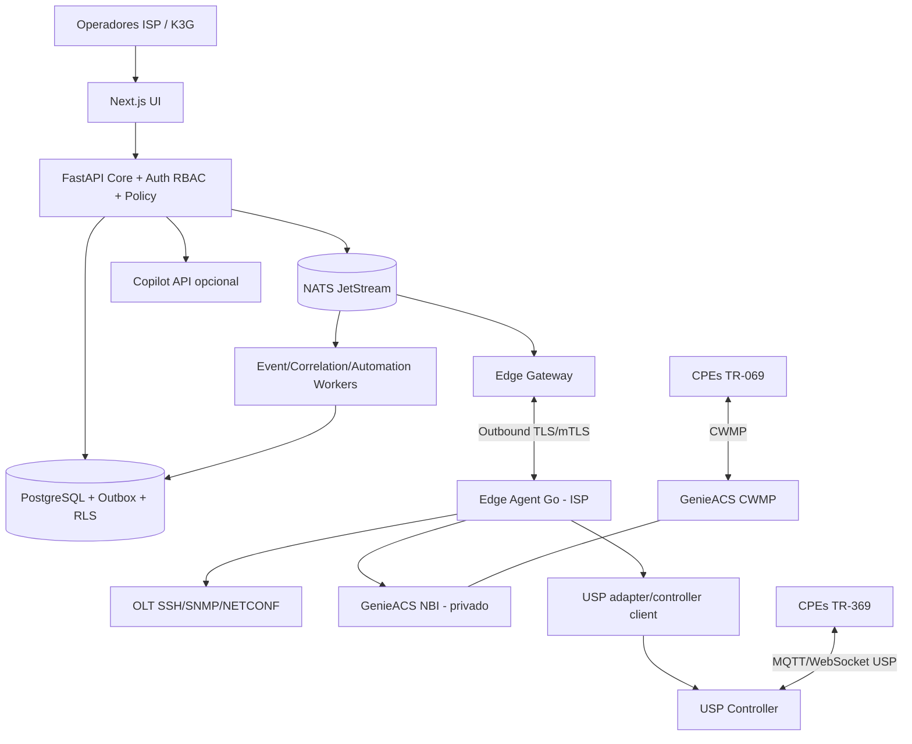

# Arquitetura de referência — FiberCore AI v2

## Decisão principal: modular monolith + bounded contexts + edge plugins

Prioridade: confiabilidade operacional e velocidade de entrega, sem descartar evolução. Separar **deployables somente onde há fronteira de segurança ou carga operacional**; manter o resto modular no API Core. Cada módulo define contratos, migrations próprias, permissões, métricas e fallback.

### Camadas

| Camada | Tecnologia | Responsabilidade | Escala |
|---|---|---|---|
| Web/BFF | Next.js 16 ou versão suportada sob lockfile + React/TS | telas, SSE/WebSocket de status, auth UI | horizontal stateless |
| API Core | FastAPI / SQLAlchemy 2 / Alembic / Pydantic 2 | tenants, auth, inventário, associação, políticas, módulo registry | horizontal stateless |
| Worker/event bus | NATS JetStream + PostgreSQL outbox | notificação assincrônica, reconciliadores, ingestão | workers por função |
| Banco | PostgreSQL (RLS + indexes + partition time series) | fonte de verdade SaaS/estado/contratos | HA quando relevante |
| Edge Gateway | Go (gRPC stream ou WS TLS) | registro dispositivo Edge, envelope jobs, throttle | horizontal por sessão/partition |
| Edge Agent | Go + SQLite WAL local | acesso isolado OLT/GenieACS, cache, jobs allowlisted | distribuído por ISP |
| USP service | USP Controller sob adapter HTTPS/mTLS | TR-369, MTP MQTT/WS según controlador | independente por tenant/ambiente |
| CWMP service | GenieACS **preexistente em host privado ISP** | TR-069, tasks/provisions/presets/files | operado localmente |
| Optional copiloto | Python service + OpenAI-compatible provider adapters | RAG, sugestões, tool facade read-only | isolado, opcional |
| Observability | Prometheus, Grafana, Loki/OTel (tracing) | módulos, filas, edge e UX | independente |

**Versões de software:** atualizar e pin após teste (commit lockfiles e image digests), sem usar `latest` na produção. Deploy de Redis, object store, TimescaleDB, Temporal e Kubernetes **opcionais**: ativar mediante necessidade comprovada.

### Diagrama lógico

### Edge networking e fluxo

- Cloud **não** recebe portas de gerenciamento das OLTs nem NBI pública.
- Edge inicia saída TCP 443 ao Gateway, valida certificado do servidor, autentica identidade por certificado curto e token rotativo de bootstrap; revogação imediata.
- GenieACS NBI pode estar em outro host privado acessível ao Edge. Service URL configurado no Edge, não vindo livremente do Cloud para evitar SSRF; limitar host/porta e DNS/IP.
- TR-069: CPE precisa alcançar CWMP local/host ACS existente; Connection Request pode não funcionar por NAT. Status task `queued | dispatched | device_ack | verified | expired | failed | unknown`.
- TR-369: equipamento conversa com controlador USP via MTP habilitado; **não pressupor que OB-USPC está adequado a produção**; escolha após PoC, segurança, suporte transporte, supervisão, HA e licenciamento.
- Dual-stack: identidade canônica por fabricante+serial/OUI+certificados+evidências; não juntar por MAC sozinho; cada capability aponta `chosen_transport`, fallback, direito de escrita e versão do modelo de dados.
- Protocolos TR-098 e TR-181: mapear `InternetGatewayDevice.*` e `Device.*` para `canonical.*`, guardando raw paths, types, default/null, origin. A raiz TR-181 não garante todo parâmetro em todos os vendors.

### Fluxo de dados e consistência

1. Adapters coletam snapshot/evento com `schema_version`, `tenant_id`, `site_id`, `collector_id`, `sequence`, `observed_at`, `quality`.
2. Ingestão recebe em API/gateway validado, grava ingest token e outbox, desduplica `event_id` e sequence.
3. Workers aplicam normalização, vínculo, métricas e incidentes com retry/dead-letter.
4. UI consulta estado materializado; se stale mostra selo com motivo, nunca apresenta como novo.
5. Envelopes de comando têm hash prévio/target, `expires_at`, approval id e política de risco; Edge valida novamente.

### Isolamento e atualização

- Cada domínio define route prefix, health, migrations, `capabilities`, feature flag, versão de contrato, dependências mínimas.
- Falha de `copilot` ou `usp` **não** impede API de inventário/GenieACS. Bootstrap usa dependências críticas: PostgreSQL, autenticação; demais opcionais em modo degraded.
- Mudanças de schema via **expand → migrate/backfill → contract**, API backward-compatible pelo menos um ciclo de release; deploy independente não deve produzir breaking change sem anúncio/versão.
- Canary com métricas, pause e rollback; rollback de código não garante reversão de schema ou firmware. Planejar restauração e caminhos compensatórios.

### Quando migrar para K3s/Kubernetes

Compose atende desenvolvimento e piloto controlado, mas não HA real. Gatilhos: SLA contratual, necessidade >=2 réplicas, falha de host, rolling updates contínuos, separação ambientes/escala. Requisitos prévios: PostgreSQL HA externo ou operador com backup/teste; NATS cluster HA; ingress TLS; readiness/startup/liveness, `PodDisruptionBudget`, `maxUnavailable:0`, replicas>=2 e estratégia de job dedup. Kubernetes não resolve banco/estado sozinho.

### ADRs obrigatórias

`ADR-0001`: monólito modular; `0002`: agent outbound; `0003`: GenieACS existente; `0004`: USP desacoplado; `0005`: outbox+JetStream; `0006`: multi-tenant RLS; `0007`: no implicit retries writes; `0008`: Compose->K3s; `0009`: dual-stack resolution; `0010`: opt-in LLM gateway. Modelo em docs/wiki/adr/TEMPLATE.md.
