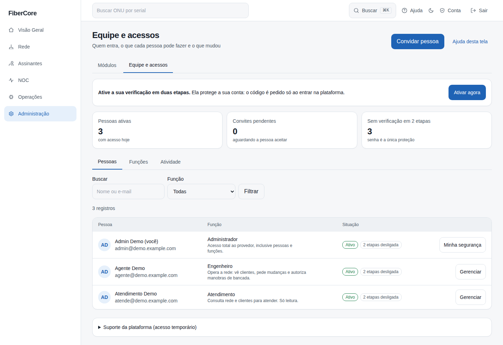
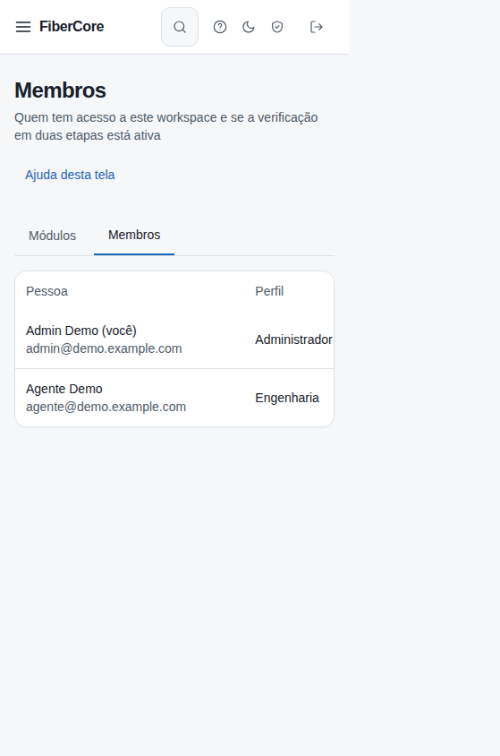

# Como ver os membros e redefinir o MFA de alguém

**Objetivo:** saber quem tem acesso ao workspace e se a verificação em duas etapas (MFA) está ativa; e, quando alguém perde o celular **e** os códigos de recuperação, redefinir o MFA dessa pessoa.

**Antes de começar:** Ver a lista exige a permissão `members:read`. Redefinir exige `members:mfa_reset` (administrador) **e** que o seu próprio MFA esteja ativo (Conta › Segurança da conta): a ação pede a sua senha e um código seu.

## Passo a passo

1. Acesse **Administração › Equipe e acessos**. Cada pessoa mostra **2 etapas ligada** ou **desligada**.
2. Na linha da pessoa, clique em **Gerenciar** e abra **Redefinir a verificação em duas etapas** (só para quem tem a verificação ligada e não é você).
3. Leia o aviso e digite **sua senha** e **seu código** (do autenticador ou um código de recuperação seu).
4. Confirme em **Redefinir verificação**. A pessoa volta a **2 etapas desligada**; peça que ela cadastre o MFA de novo em Conta › Segurança da conta.

## Resultado esperado

- O MFA e os códigos de recuperação da pessoa são apagados e as sessões abertas dela são encerradas.
- Se o perfil dela exige MFA, o acesso fica **bloqueado até ela cadastrar de novo** (nunca fica liberado).
- A ação fica na auditoria com o seu nome.

## Permissões necessárias

`members:read` para ver; `members:mfa_reset` para redefinir (administrador do provedor).

## Se algo não funcionar

- **“Ative o seu próprio MFA…”:** a redefinição só vale para quem tem MFA ativo.
- **“Esta conta também pertence a outros workspaces”:** o MFA é da conta inteira; só o suporte da plataforma pode redefini-lo.
- **“Muitas tentativas”:** aguarde 15 minutos; as tentativas erradas de senha ou código contam.
- **Não consegue redefinir o seu próprio:** use Conta › Segurança da conta.
