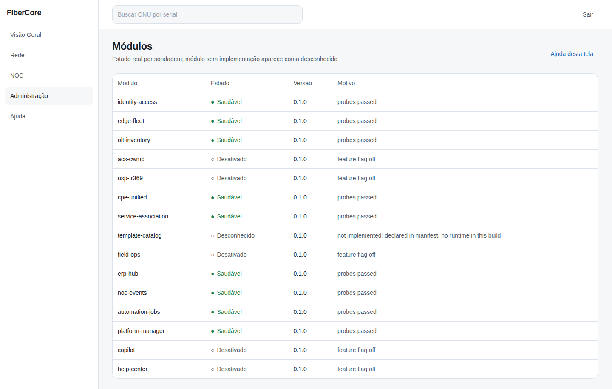
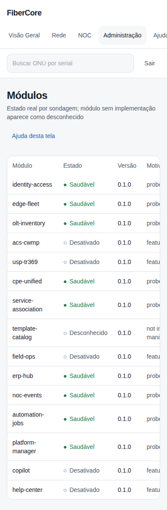

# Como verificar a saúde dos módulos

**Objetivo:** ver quais módulos da plataforma estão saudáveis, degradados, desativados ou ainda não implementados.

**Antes de começar:** Qualquer usuário autenticado do workspace pode consultar. O estado vem de sondagens reais (banco de dados e mensageria).

## Passo a passo

1. Acesse **Administração** no menu lateral.
2. Leia a coluna **Estado** (texto e símbolo).
3. Leia **Motivo** para entender a causa de qualquer estado diferente de Saudável.

## Resultado esperado

Módulo sem implementação aparece como **desconhecido**, nunca como saudável; módulos desativados por feature flag aparecem como **Desativado**.

## Permissões necessárias

Qualquer papel autenticado (leitura).

## Se algo não funcionar

- **Indisponível:** uma dependência obrigatória (ex.: banco) está fora; abra um chamado interno.
- **Degradado:** uma dependência opcional (ex.: mensageria) está fora; a operação de inventário continua.

## Evidências de documentação

- Build/commit: 1d9fb94 (árvore de trabalho do PR)
- Browser/viewport: Chromium; desktop 1440×900 e mobile 390×844
- Caso de teste E2E: help-screenshots.spec.ts › administracao/saude-modulos
- Dados: fictícios (seed `scripts/seed_demo.py`); sem informações reais de clientes
