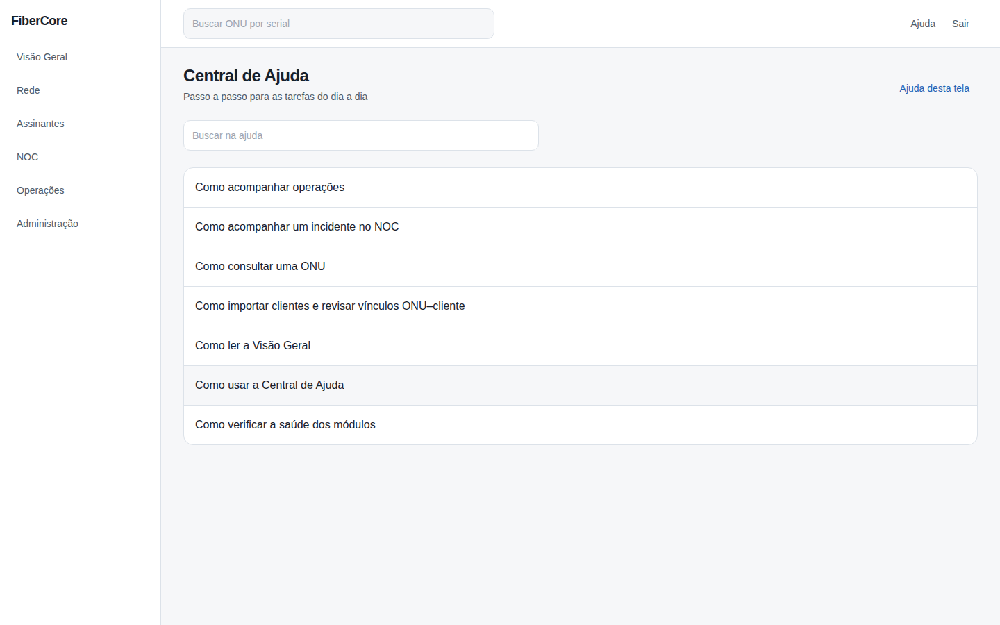
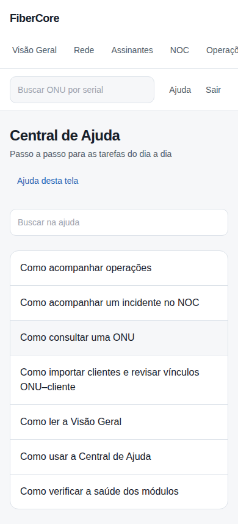

# Como usar a Central de Ajuda

**Objetivo:** encontrar o passo a passo de cada tela.

**Antes de começar:** Autenticação necessária. A ajuda só exibe manuais do produto.

## Passo a passo

1. Acesse **Ajuda** na barra superior ou clique em **Ajuda desta tela** em qualquer tela.
2. Use **Buscar na ajuda** para filtrar por palavra.
3. Abra o artigo; o rodapé mostra a versão do produto e a data da última validação.

## Resultado esperado

A lista mostra os artigos; artigos ainda sem capturas validadas aparecem como **em elaboração**.

## Permissões necessárias

Qualquer papel autenticado.

## Se algo não funcionar

- **Artigo não encontrado:** o link pode ter mudado; volte à lista e busque pelo título.

## Evidências de documentação

- Build/commit: 1d9fb94 (árvore de trabalho do PR)
- Browser/viewport: Chromium; desktop 1440×900 e mobile 390×844
- Caso de teste E2E: help-screenshots.spec.ts › ajuda/central-de-ajuda
- Dados: fictícios (seed `scripts/seed_demo.py`); sem informações reais de clientes
