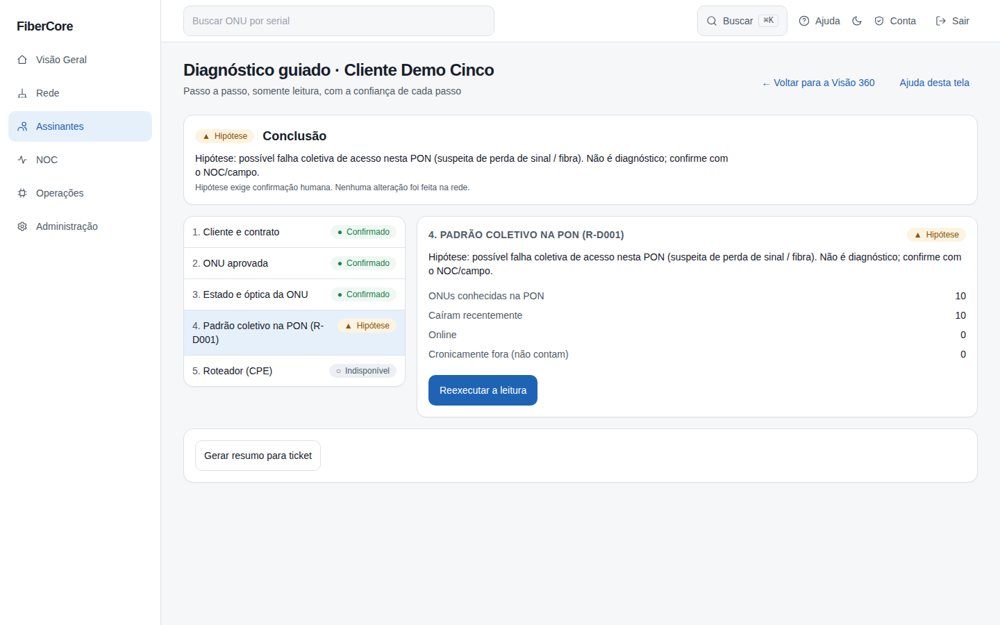
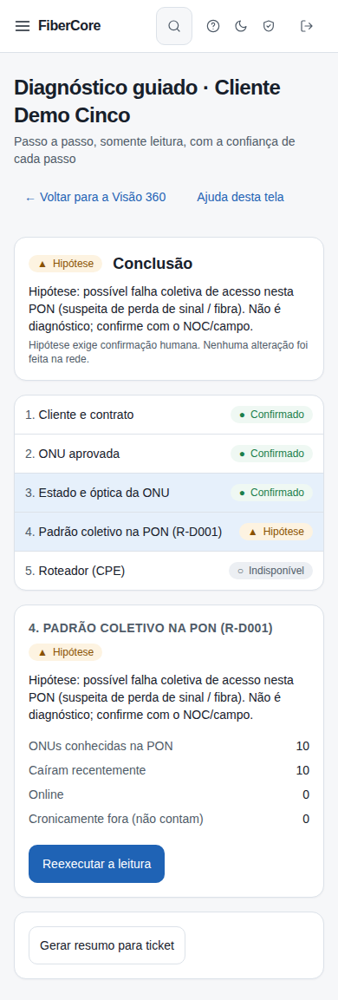

# Como usar o Diagnóstico guiado

**Objetivo:** conduzir o atendimento de um cliente "sem conexão" passo a passo, com uma conclusão honesta e a confiança de cada passo, usando só dados já coletados (somente leitura).

**Antes de começar:** recursos `subscriber_360`, `customer_context` e `diagnostic_engine` ligados para o seu provedor. Permissão `customers:read`; para **executar** o diagnóstico, `diagnostics:run` (isp_admin, engineer, noc_n2). O cliente precisa ter uma ONU aprovada.

## Passo a passo

1. Abra a **Visão 360** do cliente (**Assinantes › Ver 360**) e clique em **Diagnóstico guiado**.
2. Leia a **Conclusão** no topo. Ao abrir, ela costuma dizer "Sem conclusão": o diagnóstico ainda não foi executado.
3. Percorra os 5 passos na coluna da esquerda: **Cliente e contrato**, **ONU aprovada**, **Estado e óptica da ONU**, **Padrão coletivo na PON (R-D001)** e **Roteador (CPE)**. O painel da direita mostra o resumo, os fatos e a fonte/idade de cada dado.
4. No passo 4, clique em **Executar diagnóstico (somente leitura)**. A leitura usa o que já foi coletado e **não altera nada na rede**; o resultado fica registrado e pode ser reproduzido.
5. Para abrir um chamado, use **Gerar resumo para ticket** e copie o texto.

## Resultado esperado

Cada passo traz um rótulo (texto + símbolo): **Confirmado** (fato medido e recente), **Hipótese** (derivada de fatos; exige confirmação humana) ou **Indisponível** (dado velho ou ausente: nada é afirmado). A conclusão nunca é um diagnóstico definitivo nem uma nota de "saúde".

## Como ler a conclusão
- **Hipótese:** várias ONUs da mesma PON caíram juntas; o sistema sugere uma falha coletiva (fibra/LOS ou energia). Confirme com o NOC ou o campo.
- **Confirmado (sem padrão):** as quedas recentes não atingem o padrão coletivo. A causa pode ser local ao cliente, mas isso **não** foi determinado.
- **Indisponível / "Sem conclusão":** falta dado recente ou o diagnóstico não foi executado. Dado defasado é o último estado conhecido, não uma queda confirmada.

## Permissões necessárias

`customers:read`; `diagnostics:run` para executar (sem ela os passos 1–3 e 5 aparecem e o passo 4 fica Indisponível).

## Se algo não funcionar

- **A tela não existe / página não encontrada:** o recurso está desligado para o seu provedor.
- **"Seu papel não permite executar o diagnóstico":** falta `diagnostics:run`.
- **"Nenhuma ONU aprovada":** aprove o vínculo ONU↔cliente em **Assinantes**.
- **Tudo "Indisponível":** a coleta está velha; aguarde a próxima coleta da OLT e reexecute.
