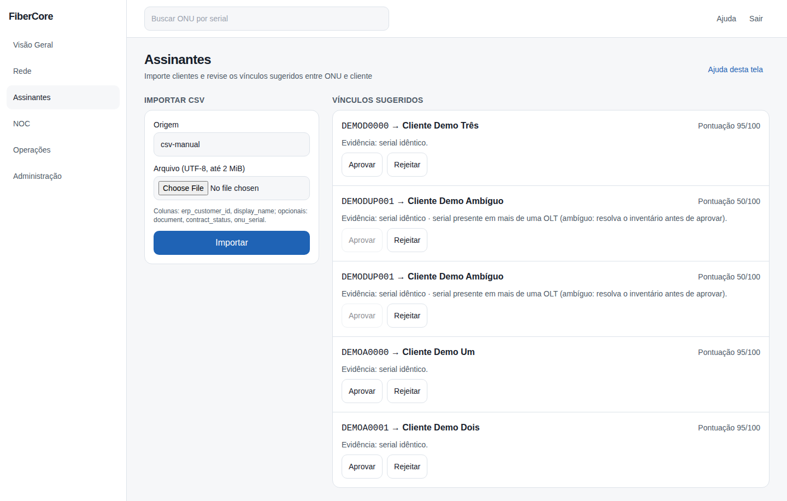
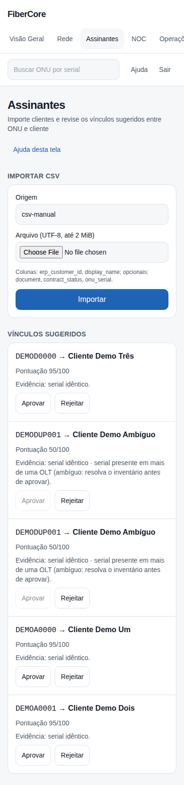

# Como importar clientes e revisar vínculos ONU–cliente

**Objetivo:** importar uma planilha de clientes e aprovar ou rejeitar os vínculos sugeridos com as ONUs.

**Antes de começar:** Importar exige permissão de administrador do provedor; revisar vínculos exige `associations:review`. O CSV deve estar em UTF-8, ter até 2 MiB e 5.000 linhas.

## Passo a passo

1. Acesse **Assinantes** no menu lateral.
2. Em **Importar CSV**, informe a **Origem** (ex.: csv-manual), escolha o arquivo e clique em **Importar**.
3. Leia o relatório: mostra apenas contagens (aceitas, rejeitadas, sugestões, conflitos); os valores das linhas rejeitadas **não** são exibidos.
4. Em **Vínculos sugeridos**, confira o serial, o cliente e a pontuação.
5. Clique em **Aprovar** (ou **Rejeitar**) e depois em **Confirmar** — a ação só vale após a confirmação.

## Resultado esperado

O vínculo aprovado sai da lista de sugestões. Cada ONU só pode ter um cliente aprovado. A aprovação é registrada na auditoria.

## Permissões necessárias

`customers:import` (importar), `associations:review` (aprovar/rejeitar), `customers:read` (ver).

## Se algo não funcionar

- **Vínculo ambíguo:** o mesmo serial aparece em mais de uma OLT; o botão Aprovar fica bloqueado até o inventário ser corrigido.
- **Conflito:** a ONU já tem outro cliente aprovado; rejeite o vínculo antigo antes.
- **Linhas rejeitadas:** confira as colunas e os formatos (documento com 11 ou 14 dígitos, status válido).
- **Sem permissão:** peça ao administrador o papel adequado.

## Evidências de documentação

- Build/commit: árvore de trabalho do PR web/14
- Browser/viewport: Chromium; desktop 1440×900 e mobile 390×844
- Caso de teste E2E: help-screenshots.spec.ts › assinantes/importar-e-revisar-vinculos; app.spec.ts › assinantes (2 testes)
- Dados: fictícios (seed `scripts/seed_demo.py`); sem informações reais de clientes
