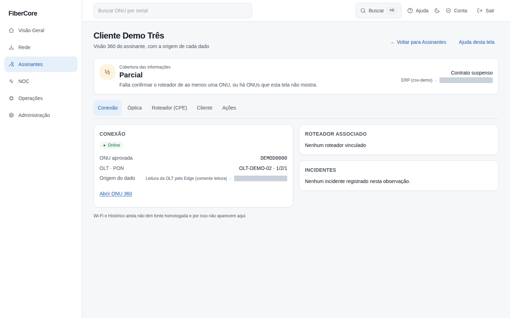
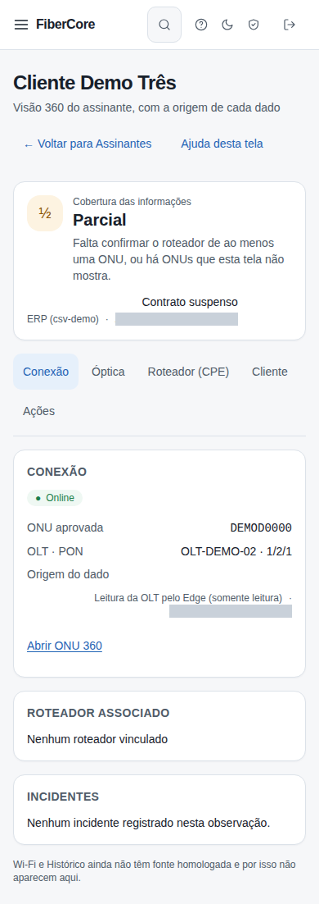

# Como ver a Visão 360 do assinante

**Objetivo:** ver, em uma tela, a situação de um cliente (contrato, ONU, sinal e roteador) sabendo de onde vem cada informação e quão recente ela é.

**Antes de começar:** o recurso precisa estar ligado para o seu provedor (flag `subscriber_360`, liberada pelo responsável da plataforma). Permissão `customers:read`; o bloco de incidente exige também `incidents:read`. Cada visualização é registrada na auditoria.

## Passo a passo

1. Abra **Assinantes**. Com o recurso ligado, aparece a lista **Clientes · visão 360** (20 por página; use a caixa de busca para filtrar pelo nome, sem diferenciar maiúsculas).
2. Clique no cliente (**Ver 360 →**).
3. Leia o **Estado geral** no topo: **Completo**, **Parcial**, **Defasado** ou **Desconhecido**, com a frase que explica o motivo.
4. Se o cliente tiver mais de uma ONU, escolha a ONU pelo serial.
5. Navegue pelas abas: **Conexão**, **Óptica**, **Roteador (CPE)**, **Cliente** e **Ações**. Cada bloco mostra a **fonte**, a **idade** do dado e se está **Atualizado** ou **defasado**.

## Resultado esperado

Uma visão só de leitura. Nada nesta tela altera a rede. Wi-Fi e Histórico não aparecem porque ainda não têm fonte homologada.

## Como ler o estado geral
- **Completo:** contrato, ONU e roteador confirmados, todos com dado recente.
- **Parcial:** falta confirmar o roteador de alguma ONU, ou o cliente tem mais ONUs do que a tela mostra (nunca é "Completo" nesse caso).
- **Defasado:** algum dado está velho; é o último estado conhecido, não uma queda confirmada.
- **Desconhecido:** nenhuma ONU aprovada para o cliente; a tela não afirma nada sobre a conexão.

## Permissões necessárias

`customers:read` (e `incidents:read` para ver incidentes). O roteador só aparece depois que uma pessoa confirma o vínculo ONU↔CPE (revise na **ONU 360**).

## Se algo não funcionar

- **A lista Clientes não aparece / página não encontrada:** o recurso está desligado para o seu provedor.
- **"Sem acesso":** seu papel não tem `customers:read`.
- **"Nenhuma ONU aprovada":** aprove o vínculo ONU↔cliente em **Assinantes**.
- **"Seu papel não permite ver incidentes":** falta `incidents:read`; isso não significa que não haja incidente.
- **"Falha ao carregar":** recarregue; isso não significa que o cliente não tenha ONU.
