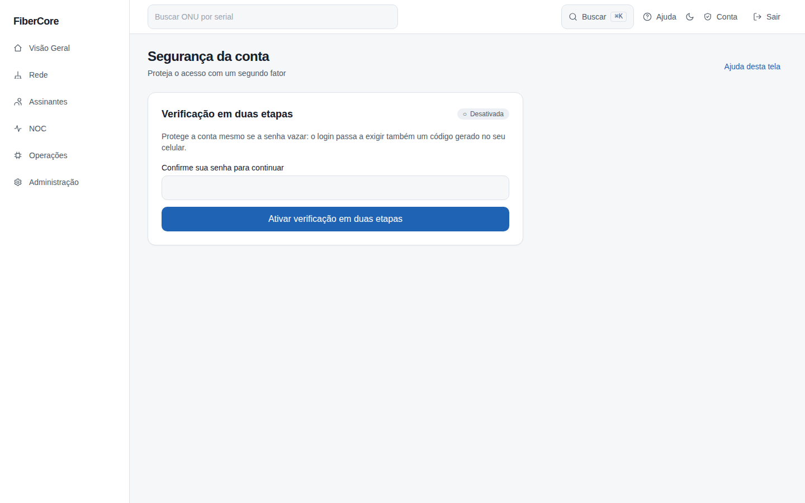
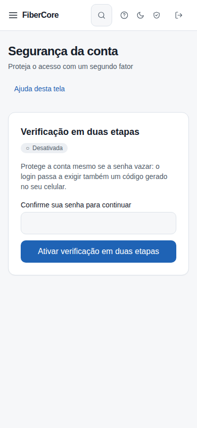

# Como ativar a verificação em duas etapas

**Objetivo:** proteger a sua conta com um segundo fator: além da senha, o login passa a pedir um código de 6 dígitos gerado no seu celular.

**Antes de começar:** tenha um aplicativo autenticador instalado (Google Authenticator, Microsoft Authenticator, Aegis ou similar) e a sua senha atual. Se o seu perfil exigir a verificação, as demais telas ficam bloqueadas até você concluir estes passos.

## Passo a passo

1. Clique em **Conta** (ícone de escudo) no topo da tela. Abre **Segurança da conta**.
2. Digite a sua senha atual e clique em **Ativar verificação em duas etapas**.
3. No aplicativo autenticador, adicione uma conta e escaneie o **QR code**. Se não puder escanear, digite a **chave** mostrada abaixo do QR code.
4. Digite o código de 6 dígitos que o aplicativo mostrar e clique em **Confirmar e ativar**.
5. Copie ou baixe os **8 códigos de recuperação**, marque **Guardei os códigos em um lugar seguro** e clique em **Concluir**.

## Resultado esperado

O estado muda para **Ativa** e a tela mostra quantos códigos de recuperação ainda restam. No próximo login, depois da senha, o sistema pede o código do aplicativo.

## Códigos de recuperação

Cada código funciona **uma única vez** e serve se você perder o celular. Eles aparecem **somente nesta etapa** e não podem ser vistos de novo: guarde-os em um gerenciador de senhas ou impressos em local seguro. Se restarem poucos, a tela avisa.

## Como desativar

Em **Segurança da conta**, abra **Desativar verificação em duas etapas**, informe a senha e um código do aplicativo (ou um código de recuperação). Se o seu perfil exigir a verificação, ela **não pode ser desativada**.

## Se algo não funcionar

- **Código incorreto:** confira se a hora do celular está automática; o código muda a cada 30 segundos e cada código só vale uma vez.
- **Muitas tentativas:** aguarde 15 minutos antes de tentar de novo.
- **Cadastro indisponível:** o ambiente não tem a chave de criptografia configurada; avise o administrador da plataforma.
- **Perdi o celular e os códigos:** peça ao administrador para redefinir a sua verificação.

## Evidências de documentação

- Build/commit: árvore de trabalho do PR
- Browser/viewport: Chromium; desktop 1440×900 e mobile 390×844
- Caso de teste E2E: help-screenshots.spec.ts › conta/ativar-verificacao-em-duas-etapas; app.spec.ts › Segurança da conta
- Dados: fictícios (seed `scripts/seed_demo.py`); sem informações reais de clientes
