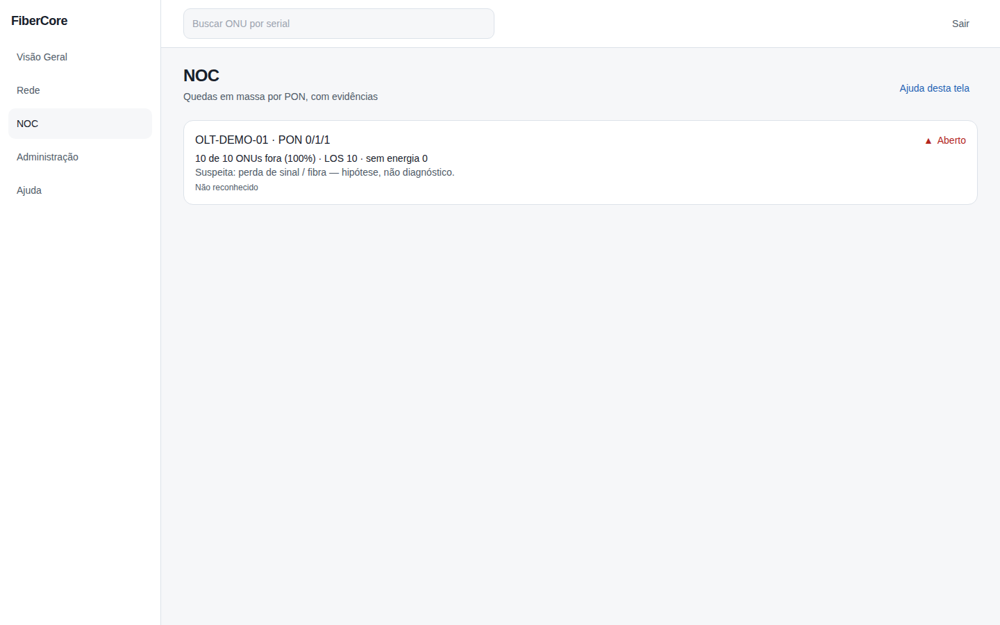
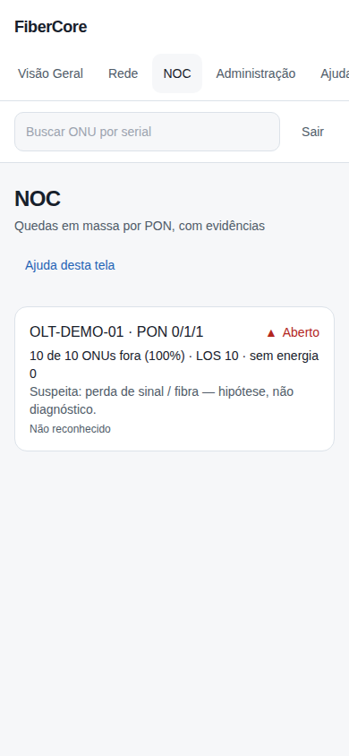

# Como acompanhar um incidente no NOC

**Objetivo:** acompanhar quedas em massa por PON e entender as evidências sem tirar conclusões precipitadas.

**Antes de começar:** Permissão `incidents:read`. Um incidente só é aberto quando a PON foi lida por completo, tem pelo menos 5 ONUs e 80% ou mais fora.

## Passo a passo

1. Acesse **NOC** no menu lateral.
2. Leia o título (OLT e PON) e as evidências: ONUs fora, LOS e falta de energia.
3. Leia a **causa suspeita**: é uma hipótese, não um diagnóstico.
4. Se aparecer o aviso **Edge silencioso**, o estado exibido é o último conhecido e não está confirmado agora.

## Resultado esperado

Incidentes abertos aparecem primeiro, com o estado e a contagem de evidências. Incidentes se resolvem sozinhos quando a PON se recupera (abaixo de 50%).

## Permissões necessárias

`incidents:read`; reconhecer incidente exige `incidents:ack` (isp_admin, engineer, noc_n2).

## Se algo não funcionar

- **Edge silencioso:** a falta de dados não abre nem fecha incidentes; verifique o Edge.
- **Incidente não aparece:** PON com menos de 5 ONUs ou leitura parcial não gera incidente.
- **Sem permissão:** seu papel não permite ver incidentes.

## Evidências de documentação

- Build/commit: 1d9fb94 (árvore de trabalho do PR)
- Browser/viewport: Chromium; desktop 1440×900 e mobile 390×844
- Caso de teste E2E: help-screenshots.spec.ts › noc/acompanhar-incidente; app.spec.ts › dados defasados
- Dados: fictícios (seed `scripts/seed_demo.py`); sem informações reais de clientes
