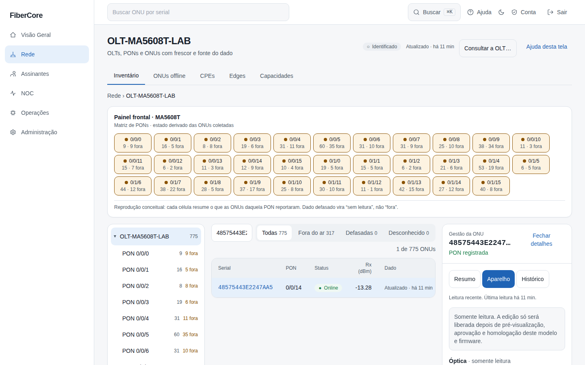
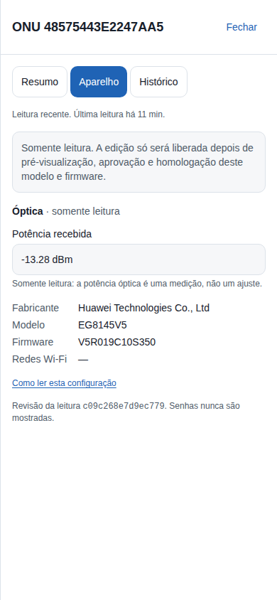

# Como ver a configuração do aparelho do cliente (somente leitura)

**Objetivo:** consultar, sem alterar nada, o Wi-Fi, a LAN, a WAN e a potência óptica do roteador/ONT ligado a uma ONU, sabendo de quando é cada dado.

**Antes de começar:** o recurso **Configuração do aparelho** precisa estar ligado para o provedor e a ONU precisa ter um roteador (CPE) **com vínculo confirmado** (veja “Como consultar uma ONU”). Permissão de leitura do inventário.

## Passo a passo

1. Em **Rede**, clique no serial da ONU e abra a aba **Aparelho** do painel de detalhes (ela só existe se a ONU tem roteador com vínculo confirmado). Na **ONU 360°** o mesmo conteúdo abre pelo botão **Configuração do aparelho**, no cartão **Roteador (CPE)**.
2. Em **Resumo** veja a miniatura do aparelho, o fabricante/modelo/firmware, a **óptica** (potência recebida e transmitida, sempre somente leitura) e quando foi a última leitura.
3. Use as abas **Wi-Fi**, **LAN** e **WAN**. Elas só aparecem se o aparelho informou aquela parte. Em Wi-Fi, quando há mais de uma rede, escolha a rede em **Rede**: o painel mostra a banda que o **próprio aparelho** informou (se ele não informou, diz “banda não informada”).
4. Para fechar, clique em **Recolher** ou tecle **Esc**. O foco volta ao botão.

## O que você precisa saber

- **É só leitura.** Todos os campos aparecem bloqueados, com o motivo. Alterar Wi-Fi, LAN ou WAN só será liberado depois de pré-visualização, aprovação e homologação do modelo e do firmware.
- **Senhas nunca aparecem.** O painel mostra apenas “definida” ou “não definida”.
- **Dados sintéticos** aparecem com um aviso: são de demonstração e não vieram do aparelho.
- **Defasado:** campos com mais de 1 hora ganham o aviso “defasado”; sem nenhuma leitura há mais de 24 horas o painel avisa que a fonte parou de enviar.
- **Óptica** é uma medição da fibra, não um ajuste: não existe botão para mudá-la.

> **Estado atual do laboratório (31/10/2026):** a captura acima é real. Hoje só aparecem fabricante, modelo, firmware e a **óptica** (vinda da OLT). As abas Wi-Fi, LAN e WAN ainda não têm dado porque a leitura da configuração pelo gerenciador do aparelho ainda não foi liberada; o painel mostra “—” em vez de inventar valores.

## Se algo não funcionar

- **O botão não aparece:** o recurso está desligado para o provedor ou a ONU ainda não tem roteador com vínculo confirmado.
- **“Ainda não há leitura”:** a gerência remota do aparelho ainda não informou a configuração; nada foi inventado.
- **“Não foi possível carregar”:** tente de novo; isso não significa que o aparelho não tenha dados.

## Evidências de documentação

- Build/commit: be94359 (LAB, ramo principal após o PR 106)
- Browser/viewport: Chromium; desktop 1440×900 e mobile 390×844
- Origem: capturas REAIS do ambiente de laboratório com usuário de leitura (papel NOC N1), só a ONU de bancada (a lista foi filtrada pelo serial; a matriz e a árvore mostram apenas contagens); nenhuma ONU de cliente aparece
- Dados: ONU de bancada (Huawei EG8145V5); horários relativos mascarados na lista
