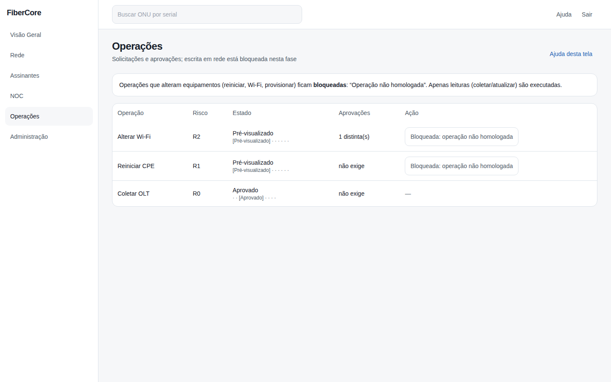
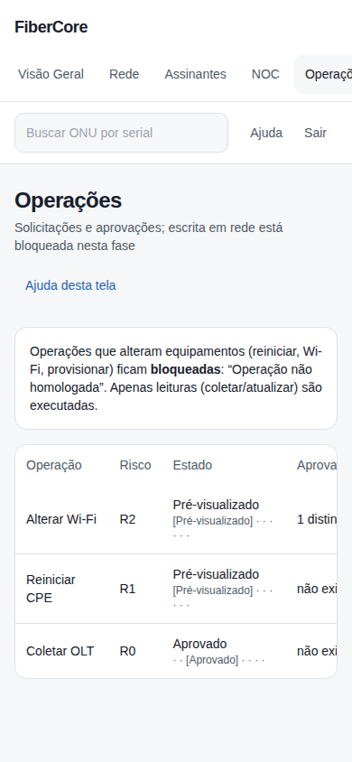

# Como acompanhar operações

**Objetivo:** ver as solicitações de operação, seu estado e por que operações de escrita estão bloqueadas.

**Antes de começar:** Permissão `jobs:read`. Nesta fase só leituras (coletar/atualizar) são executadas; alterações em equipamentos estão bloqueadas.

## Passo a passo

1. Acesse **Operações** no menu lateral.
2. Leia o aviso no topo: operações que alteram equipamentos aparecem como **Operação não homologada**.
3. Na tabela, confira **Risco**, **Estado** e **Aprovações**. Estados como Despachado e Aceito **não** são sucesso.
4. Sucesso só aparece como **Sucesso verificado**, após a verificação pós-execução.

## Resultado esperado

Operações de escrita mostram o botão **Bloqueada: operação não homologada** desabilitado; leituras seguem o fluxo até o sucesso verificado.

## Permissões necessárias

`jobs:read`; solicitar exige `jobs:request`; aprovar exige `jobs:approve` (quem solicitou não aprova a própria operação).

## Se algo não funcionar

- **Resultado desconhecido:** o equipamento não confirmou a verificação; não presuma sucesso.
- **Expirado:** a operação não foi aprovada/despachada a tempo; solicite novamente.
- **Sem permissão:** seu papel não permite ver operações.

## Evidências de documentação

- Build/commit: árvore de trabalho do PR web/14
- Browser/viewport: Chromium; desktop 1440×900 e mobile 390×844
- Caso de teste E2E: help-screenshots.spec.ts › operacoes/acompanhar-operacoes; app.spec.ts › operações
- Dados: fictícios (seed `scripts/seed_demo.py`); sem informações reais de clientes
