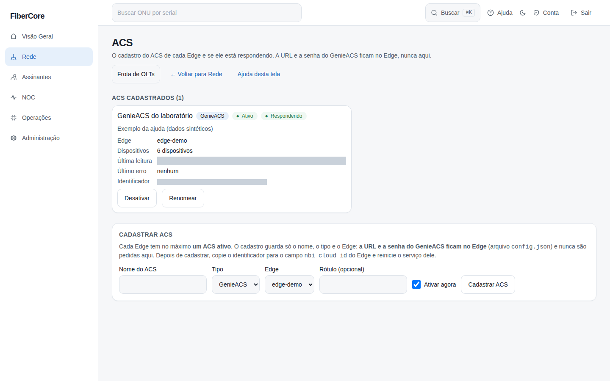
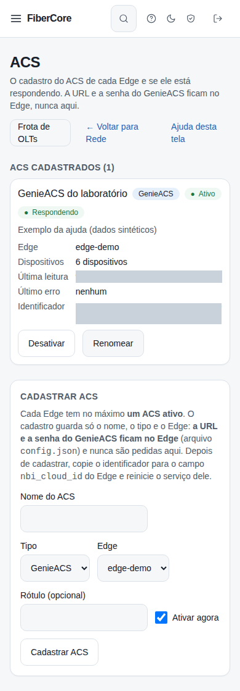

# Como cadastrar e acompanhar o ACS de cada Edge

**Objetivo:** registrar na nuvem qual ACS (hoje, o GenieACS) cada Edge do seu provedor usa e ver se ele está respondendo, quantos dispositivos ele tem e qual foi o último erro, tudo em português.

**Antes de começar:** o recurso **ACS** precisa estar ligado para o provedor (flag `acs_registry`, ligada pelo dono da plataforma). Ver a lista exige o papel Administrador, Engenheiro, Operador NOC (nível 2) ou Auditor; **cadastrar, renomear, ativar e desativar** é só do Administrador. **A URL e o usuário/senha do GenieACS nunca são digitados aqui nem guardados na nuvem:** ficam no arquivo `config.json` do Edge, e a tela só guarda o nome, o tipo e a qual Edge o ACS pertence.

## Passo a passo

1. Em **Rede**, clique em **ACS**. A lista mostra cada ACS com o **tipo**, se está **Ativo** ou **Inativo**, o **estado** (**Respondendo**, **Com falha**, **Desatualizado** ou **Sem leitura**), o Edge, o número de **dispositivos**, quando foi a **última leitura**, o **último erro** e o **identificador**. O estado vem do relato do próprio Edge: enquanto ele não relatar, aparece **Sem leitura** e “ainda não visto” (nada é afirmado antes disso); sem relato há mais de 20 minutos, **Desatualizado** (Edge parado ou sem rede).
2. Para **cadastrar**, em **Cadastrar ACS** informe o **Nome do ACS**, o **Tipo**, o **Edge** e, se quiser, um **Rótulo**; deixe **Ativar agora** marcado e clique em **Cadastrar ACS**. Cada Edge tem **no máximo um ACS ativo** (o Edge tem uma única URL de NBI): se já houver um ativo, a tela avisa **Este Edge já tem um ACS ativo**; cadastre o novo com **Ativar agora** desmarcado ou desative o atual antes. O nome é único por Edge, sem diferenciar maiúsculas de minúsculas.
3. **Passo de quem administra o Edge:** copie o **identificador** do ACS recém-cadastrado para o campo `nbi_cloud_id` do `config.json` do Edge (ao lado do `nbi_url` que já existe) e reinicie o serviço do Edge. Daí em diante, a cada ciclo de coleta ele informa se o ACS respondeu, **sem nenhum tráfego novo ao ACS** e sem mandar URL, senha ou texto de erro. Detalhes: `docs/operations/EDGE_ACS_REGISTRY.md`.
4. Para **renomear** ou mudar o rótulo, clique em **Renomear** no cartão, altere **Nome** ou **Rótulo** e clique em **Salvar**. O identificador e tudo o que o Edge já informou **ficam** (o nome é só um rótulo). O tipo e o Edge de um ACS **não mudam**: para mover um ACS para outro Edge, cadastre um novo.
5. Para **trocar o ACS ativo** de um Edge, clique em **Desativar** no atual e depois em **Ativar** no outro (os dois precisam ser do mesmo Edge). Lembre de colocar o identificador do novo no `nbi_cloud_id` do Edge. Os CPEs lidos passam a levar a origem do ACS **ativo** no momento da leitura; trocar o ACS não reescreve os CPEs antigos, e CPEs lidos quando não havia ACS ativo ficam “sem origem atribuída”.
6. Se o Edge relatar uma falha, o **Último erro** diz em português o que aconteceu: o Edge não falou com o ACS (rede, DNS ou porta), o ACS demorou demais, recusou o usuário e a senha do NBI configurados **no Edge**, respondeu com um erro inesperado, mandou uma resposta fora do formato ou grande demais. O número de dispositivos mostrado é o da **última leitura boa**.

*Capturas reais da tela com dados sintéticos; o identificador e o horário da última leitura ficam mascarados.*

## Resultado esperado

- O ACS cadastrado aparece na lista como **Ativo** e **Sem leitura** até o Edge relatar; depois, **Respondendo** com o número de dispositivos.
- A lista mostra só os ACS **do seu provedor**: nenhum ACS, Edge ou relato de outro provedor aparece, e um Edge nunca consegue atualizar o ACS de outro.
- Nenhuma tela, resposta ou registro de auditoria traz URL, host, usuário, senha ou segredo do ACS.
- Não existe exclusão de ACS por esta tela: desative.

## Se algo não funcionar

- **Continua “Sem leitura”:** confira o `nbi_cloud_id` no `config.json` do Edge (deve ser o identificador desta tela, em minúsculas), se o serviço do Edge foi reiniciado e se o recurso `acs_registry` está ligado. Um Edge antigo ou um identificador que não é dele não causa erro: o relato é descartado e o Edge registra uma única linha de aviso.
- **“Com falha: O ACS recusou o usuário e a senha do NBI”:** corrija o arquivo de segredo do NBI **no Edge** (`nbi_secret_file`); a nuvem não tem essa senha.
- **“Desatualizado”:** o Edge não relata há mais de 20 minutos: confira o serviço e a rede dele (veja também o estado do Edge em **Edges**).
- **Sem permissão:** a tela é só de leitura para o seu papel; peça a um Administrador.
