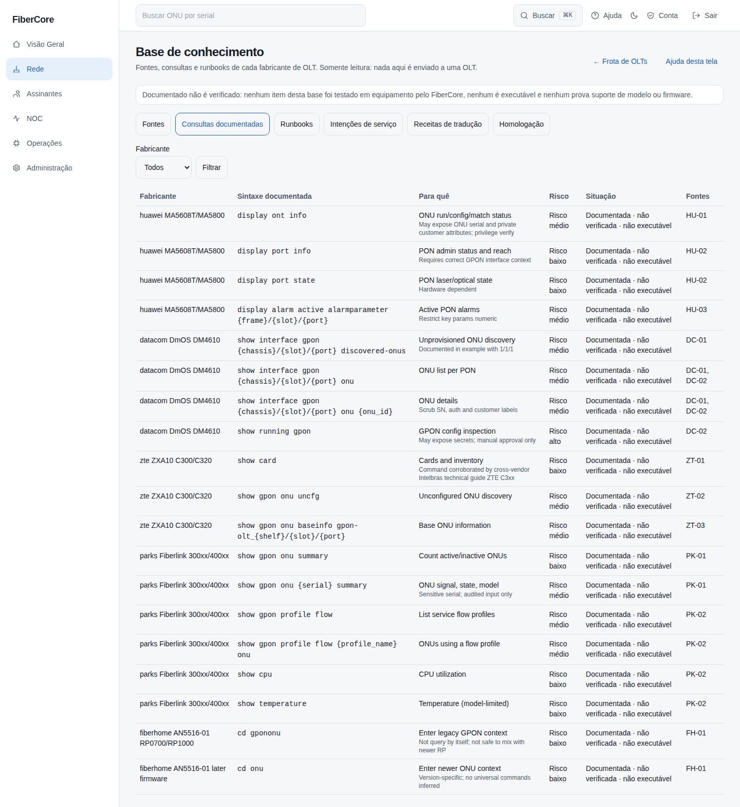
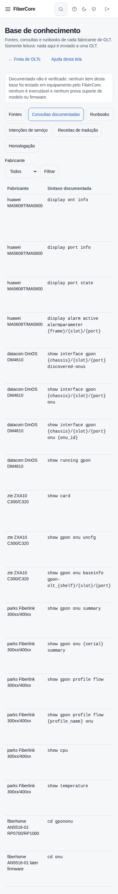

# Como consultar a base de conhecimento de OLTs

**Objetivo:** achar, num só lugar, de onde vem a informação sobre cada fabricante de OLT: fontes oficiais, consultas documentadas, runbooks de diagnóstico, intenções de serviço e o estado da homologação.

**Antes de começar:** o recurso **Frota de OLTs** precisa estar ligado para o provedor (flag `fleet_manager`). **A base é só leitura e nada nela é enviado a uma OLT.** Pelo mesmo motivo, **documentado não é verificado**: nenhum item foi testado em equipamento pelo FiberCore, nenhum é executável e nenhum prova que um modelo ou firmware é suportado.

## Passo a passo

1. Em **Frota de OLTs**, clique em **Base de conhecimento**. O aviso no topo repete a regra acima em todas as seções.
2. Use os botões de seção. **Fontes** lista 25 documentos externos (autoridade, tema e ressalva) e abre o site do fabricante em outra aba. **Consultas documentadas** mostra a sintaxe de leitura por fabricante, com o risco e a situação “documentada · não verificada · não executável”.
3. **Runbooks** traz o passo a passo de consulta e diagnóstico por fabricante; **Intenções de serviço** descreve, só como desenho, os serviços comuns (bridge, roteador, gerência TR-069 e outros); **Receitas de tradução** mostra como cada fabricante costuma cumprir uma intenção, mostra só as etapas de **leitura, verificação e pré-visualização**, sempre marcadas como exemplo não homologado. As etapas de alteração **não fazem parte da base**: a tela só informa quantas foram omitidas, porque alterar exige driver homologado, pré-visualização, aprovação e o Profile Studio. **O FiberCore não executa nem recomenda esses passos**, e os exemplos de comando são só de leitura.
4. **Homologação** mostra a matriz por fabricante: enquanto não houver evidência, a leitura fica “pendente” e a aplicação de perfil fica “blocked_by_default”.
5. Quando houver mais de um fabricante na seção, use **Fabricante** e **Filtrar** para ver só um.

*Capturas reais da tela.*

## Resultado esperado

- Você encontra a fonte e o risco de cada consulta antes de pedir uma captura ou escrever um driver.
- Nada na tela executa, aplica ou envia: não existe botão para isso.

## Erros comuns e como resolver

| Mensagem | O que significa |
|---|---|
| Página não encontrada | O recurso Frota de OLTs está desligado para o provedor |
| Sem permissão | Seu papel não permite ver a frota de OLTs |
| “A base de conhecimento falhou na verificação de segurança” | Um arquivo da base quebrou uma regra de segurança e foi recusado inteiro; avise a engenharia |

## Fontes e limites

- As descrições curtas das consultas vêm das fontes e estão em inglês; os rótulos e avisos do FiberCore estão em português.
- Os links levam a sites externos de fabricantes e integradores; podem pedir login e podem descrever outra versão de firmware que a sua. Comandos de escrita não existem nesta base.
- Para operar uma OLT use o Profile Studio e as telas de rede, que só liberam o que foi homologado.
