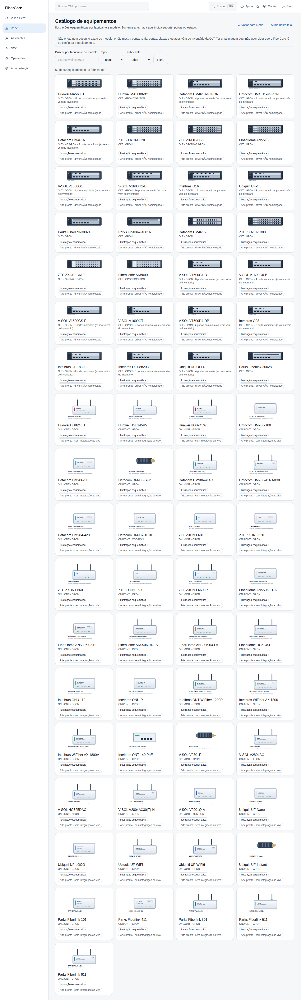

# Como usar o catálogo de equipamentos (ilustrações de OLTs e ONUs/ONTs)

**Objetivo:** reconhecer um equipamento pela miniatura e consultar o que o FiberCore tem catalogado de cada fabricante e modelo.

**Antes de começar:** o recurso **Catálogo de equipamentos** precisa estar ligado para o provedor (flag `device_assets`); desligado, o atalho e a tela não existem. **As imagens são ilustrações esquemáticas e originais: não são fotos, não são o desenho exato do modelo e não mostram portas reais.** Ter uma imagem aqui **não** quer dizer que o FiberCore lê ou configura o equipamento.

## Passo a passo

1. Em **Rede**, clique em **Catálogo de equipamentos**.
2. Use a busca (por exemplo `huawei ma5608`), o **Tipo** (OLT ou ONU/ONT) e o **Fabricante** para filtrar. A contagem mostra quantos equipamentos aparecem do total e de quantos fabricantes.
3. Cada cartão traz a miniatura, o fabricante, o modelo, a tecnologia e a quantidade **nominal** de portas do catálogo (as portas reais vêm sempre do inventário da OLT), além do rótulo **Ilustração esquemática** e da situação: **Arte pronta · driver NÃO homologado** (OLT) ou **Arte pronta · sem integração ao vivo** (ONU/ONT).
4. Na lista de OLTs da **Rede**, a miniatura aparece ao lado do nome da OLT pelo fabricante e modelo que a própria OLT informou. Um modelo que não está no catálogo aparece com o **desenho neutro** da família e o rótulo **Sem arte catalogada**: nenhuma arte de outro modelo é usada no lugar e nenhuma porta é inventada.

*Capturas reais da tela.*

## Resultado esperado

- Todo equipamento do catálogo mostra o rótulo de fidelidade; nenhum aparece como foto ou como mapa de portas.
- Modelo fora do catálogo: desenho neutro e “Sem arte catalogada”.
- O estado e as portas de uma OLT continuam vindo do inventário e do painel da OLT (veja **Como ler o painel da OLT Huawei MA5608T**), nunca da imagem.

## Se algo não funcionar

- **O atalho “Catálogo de equipamentos” não aparece:** o recurso está desligado para o provedor.
- **“Nenhum equipamento encontrado”:** a busca não bate com nenhum fabricante ou modelo; limpe os filtros.
- **A OLT aparece com o desenho neutro:** o modelo informado pela OLT não está catalogado (ou a OLT não informou fabricante e modelo). Isso não indica problema na OLT.

## Evidências de documentação

- Build/commit: árvore de trabalho do PR1 (ADR-0041)
- Browser/viewport: Chromium; desktop 1440×900 e mobile 390×844
- Caso de teste E2E: help-screenshots.spec.ts › rede/catalogo-de-equipamentos; catalogo.spec.ts
- Dados: ilustrações originais do pacote auditado (docs/addenda/v2.6/PACKAGE_AUDIT.md); sem informações de clientes
