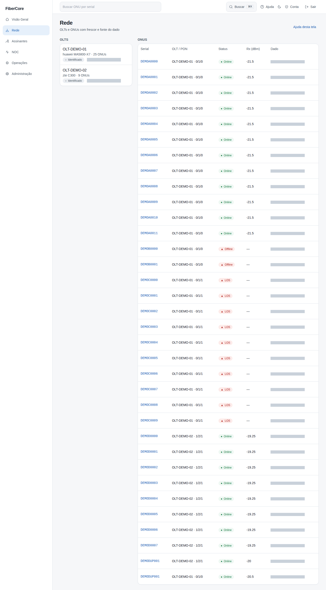
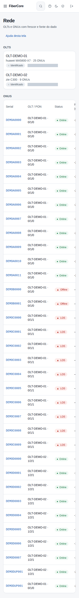

# Como consultar uma ONU

**Objetivo:** localizar uma ONU, ver seu estado, a PON, o nível óptico e a idade do dado.

**Antes de começar:** Permissão `inventory:read`. Os dados vêm do Edge do provedor; a tela mostra de quando é cada informação.

## Passo a passo

1. Acesse **Rede** no menu lateral.
2. Digite o serial na caixa **Buscar ONU por serial** e pressione Enter (ex.: DEMOA0001).
3. Clique no serial para abrir o resumo e, depois, a **ONU 360** (veja “Como ver a ONU 360”). Confira **Status**, **Rx (dBm)** e a coluna **Dado** (idade da informação).
4. Na lista de OLTs, confira o **nível de suporte** do driver: Identificado, Observado ou Certificado.

## Resultado esperado

A tabela mostra uma linha por ONU com status em texto e símbolo (a cor não é o único indicador). **Dados defasados** indicam último estado conhecido.

## Permissões necessárias

`inventory:read` (isp_admin, engineer, noc_n1, noc_n2, support).

## Se algo não funcionar

- **Nenhuma ONU encontrada:** confira o serial; se a OLT nunca foi coletada, aguarde a primeira coleta do Edge.
- **Dados defasados:** não conclua que a ONU caiu; verifique o Edge em Administração.
- **Sem permissão:** seu papel não permite ver o inventário.

## Evidências de documentação

- Build/commit: 1d9fb94 (árvore de trabalho do PR)
- Browser/viewport: Chromium; desktop 1440×900 e mobile 390×844
- Caso de teste E2E: help-screenshots.spec.ts › rede/consultar-onu; app.spec.ts › busca por serial
- Dados: fictícios (seed `scripts/seed_demo.py`); sem informações reais de clientes
