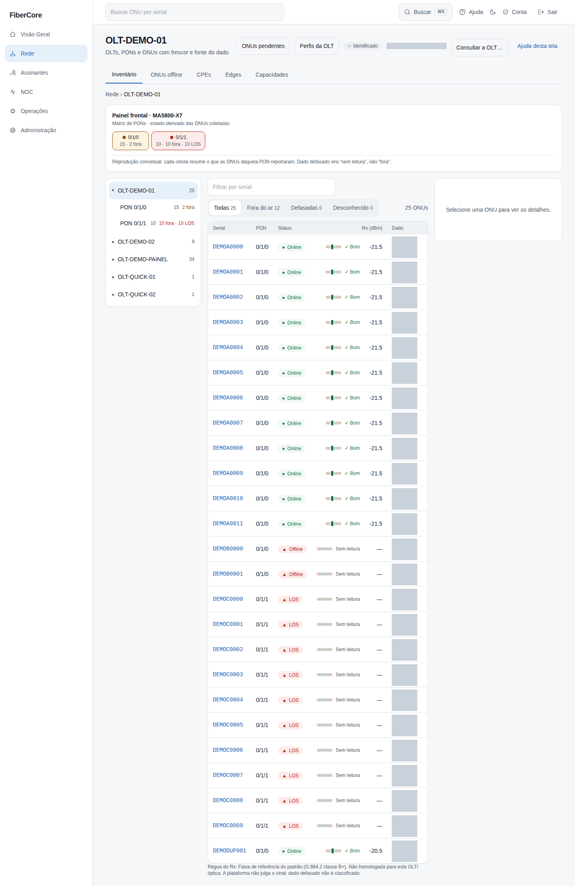
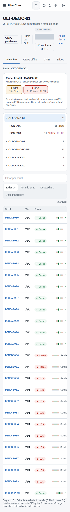

# Como consultar uma ONU

**Objetivo:** localizar uma ONU, ver seu estado, a PON, o nível óptico e a idade do dado.

**Antes de começar:** Permissão `inventory:read`. Os dados vêm do Edge do provedor; a tela mostra de quando é cada informação.

## Passo a passo

1. Acesse **Rede** no menu lateral. No topo está o **painel frontal da OLT**: uma célula por PON, com o resumo em texto (quantas ONUs e quantas fora do ar). Clique numa célula, ou numa PON da árvore à esquerda, para ver só as ONUs daquela PON; a trilha **Rede › OLT › PON** mostra onde você está.
2. Na lista, use **Filtrar por serial** e os filtros **Todas / Fora do ar / Defasadas / Desconhecido** (cada um mostra quantas ONUs há). O total aparece acima da lista.
3. Clique no serial para abrir o painel de detalhes à direita (a lista continua visível) e, de lá, **Abrir Visão 360°** (veja “Como ver a ONU 360”). Confira **Status**, **Rx (dBm)** e a coluna **Dado** (idade da informação).
4. No alto da página, confira o **nível de suporte** do driver da OLT: Identificado, Observado ou Certificado. Busca por serial na barra do topo procura em todas as OLTs.

## Resultado esperado

A tela tem três colunas lado a lado (árvore, lista e detalhes). A tabela mostra uma linha por ONU com status em texto e símbolo (a cor não é o único indicador). **Dados defasados** indicam último estado conhecido.

## Permissões necessárias

`inventory:read` (isp_admin, engineer, noc_n1, noc_n2, support).

## Se algo não funcionar

- **Nenhuma ONU encontrada:** confira o serial; se a OLT nunca foi coletada, aguarde a primeira coleta do Edge.
- **Dados defasados:** não conclua que a ONU caiu; verifique o Edge em Administração.
- **Sem permissão:** seu papel não permite ver o inventário.

## Evidências de documentação

- Build/commit: d2e519b (ramo principal; capturas regeneradas em 2026-11-02 na pilha efêmera de teste)
- Browser/viewport: Chromium; desktop 1440×900 e mobile 390×844
- Origem: capturas REAIS da aplicação integrada (pilha efêmera de teste, API e banco reais, regeneradas em 2026-11-02), com usuário administrador do seed; nenhuma ONU de cliente nem do laboratório aparece
- Dados: SINTÉTICOS (seed `scripts/seed_demo.py`: OLT-DEMO-xx e ONUs DEMOxxxx, equipamentos fictícios); horários relativos mascarados
