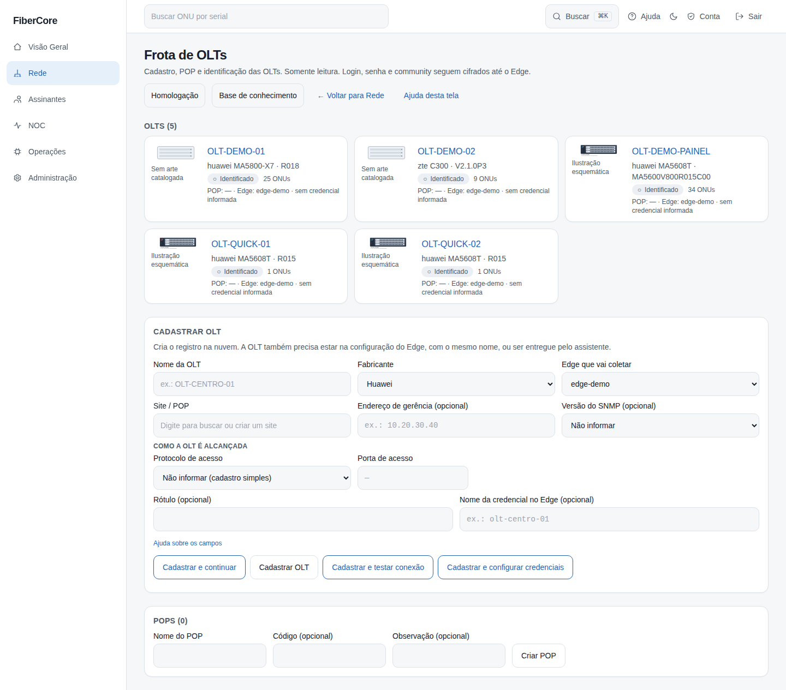
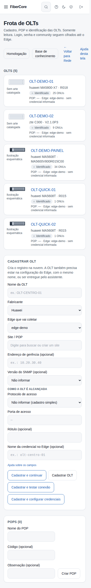
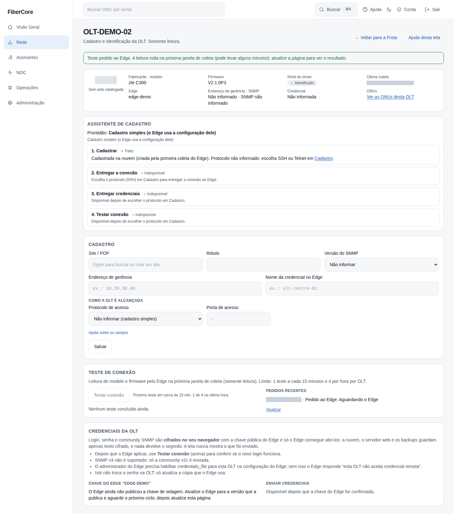
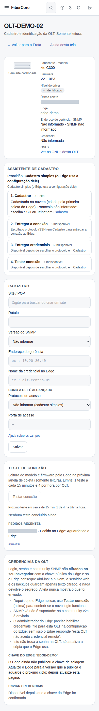

# Como cadastrar e acompanhar as OLTs (Frota de OLTs e POPs)

**Objetivo:** registrar uma OLT no FiberCore antes da primeira coleta, associá-la a um POP, e ver quais OLTs já foram lidas pelo Edge.

**Antes de começar:** o recurso **Frota de OLTs** precisa estar ligado para o provedor (flag `fleet_manager`). O **assistente de cadastro** (passos 8 a 11) exige também a flag `fleet_provision` e o papel de Administrador, e o Edge precisa ter a seção `managed_olts` na configuração dele (política local: redes, portas e fabricantes que a nuvem pode preencher). **Nada nesta tela envia comando à OLT, e a nuvem nunca guarda login, senha ou community em claro:** o cadastro guarda só o **nome** da credencial, e a entrega cifrada do passo 7 só é aberta pelo Edge.

## Passo a passo

1. Em **Rede**, clique em **Frota de OLTs**. A lista mostra cada OLT com a miniatura do modelo (quando o catálogo de equipamentos está ligado), o fabricante, o modelo e o firmware lidos pelo Edge, o nível do driver, o POP e o Edge que a coleta. Uma OLT cadastrada que ainda não foi lida aparece como **Ainda não coletada** e com o modelo **ainda não lido**: nada é afirmado antes da leitura.
2. Para criar um **POP**, preencha o nome (e, se quiser, um código e uma observação) em **POPs** e clique em **Criar POP**. O nome é único, sem diferenciar maiúsculas de minúsculas.
3. Para **cadastrar uma OLT**, preencha o nome, escolha o fabricante, o Edge que vai coletá-la e, se quiser, o **Site / POP**, o **endereço de gerência**, a **versão do SNMP** e um rótulo. No campo **Site / POP**, digite para buscar; se o nome não existir, aparece **Adicionar “nome” como novo site** e o site é criado junto com a OLT. O **endereço de gerência** é um IP (sem porta nem máscara) e, depois de salvo, só aparece mascarado (por exemplo `10.20.•.•`); ele é só cadastro, pois o Edge usa o endereço da configuração dele. No campo **Nome da credencial no Edge** informe **só o nome** do segredo guardado no Edge (letras minúsculas, números, `.`, `_` e `-`), nunca a senha, a community nem a chave: login, senha e community **não** vão neste formulário: com o recurso **Credenciais da OLT** ligado (flag `fleet_secrets`, só para o Administrador) elas são digitadas no cartão da página da OLT e **cifradas no seu navegador até o Edge** (passo 7). O botão **Cadastrar e configurar credenciais** cadastra e já leva ao cartão. Para o assistente, preencha também **Protocolo de acesso** (SSH ou Telnet, que traz a porta padrão 22 ou 23, editável), **Transporte da coleta**, **Porta SNMP**, a **Impressão digital do host SSH** e o **Modo SSH** (veja o passo 8) e use **Cadastrar e continuar**. Sem JavaScript os botões continuam funcionando, mas o endereço não é trazido para o passo seguinte: você o digita de novo lá. Valores que parecem endereço ou chave são recusados, e o valor recusado não volta na tela. O botão **Cadastrar e testar conexão** cadastra e já pede o teste de conexão (passo 6); se o teste não puder ser pedido, o cadastro continua feito.
4. **Passo de quem administra o Edge:** a OLT também precisa estar na configuração do Edge, com o **mesmo nome**. Na primeira coleta o Edge preenche modelo, firmware e nível; o POP, o rótulo e o nome da credencial cadastrados são mantidos.
5. Para editar, clique no nome da OLT, altere o site, o endereço de gerência, a versão do SNMP ou o rótulo (deixar o site ou o rótulo vazio o limpa; o endereço salvo nunca é mostrado por inteiro: digite outro para substituir ou marque **Remover o endereço**) e clique em **Salvar**. **O nome da credencial já informado nunca é mostrado de volta** (a tela só diz “Informada”): para trocá-lo, digite o novo nome em **Substituir o nome da credencial no Edge**; para tirá-lo, marque **Remover o nome da credencial**; deixando o campo vazio, ele continua como está. O nome da OLT e o Edge dono não mudam por aqui.

6. **Teste de conexão:** no detalhe da OLT, o cartão **Teste de conexão** tem o botão **Testar conexão**. Ele **pede ao Edge** que leia a identidade da OLT (modelo, firmware, patch e tempo ligada, a mesma leitura somente leitura da versão) na **próxima janela de coleta**, que pode levar alguns minutos: o pedido aparece em **Pedidos recentes** como **Aguardando o Edge** e a identidade aparece depois de **Atualizar**. O resultado mostra se a identidade **confere** ou **diverge** da que a coleta já tinha; o fabricante é o do cadastro (a leitura não o informa). **Limite por OLT: 1 teste a cada 15 minutos e 4 por hora**; dentro do limite o botão fica desligado e a tela diz quando o próximo é permitido. Se já houver uma identidade recente guardada, ela responde na hora e **nenhuma consulta é feita à OLT** (isso não gasta o limite).

7. **Credenciais da OLT (só Administrador, recurso `fleet_secrets` ligado):** no detalhe da OLT aparece o cartão **Credenciais da OLT**. (a) O **Edge publica uma chave de selagem**; o cartão mostra o estado e a **impressão digital** dela (8 grupos de 4 caracteres). Enquanto estiver **Aguardando a sua confirmação**, nada pode ser enviado. (b) No servidor do Edge rode `fibercore-edge seal-fingerprint`, **digite** o valor que ele mostra em **Digite a impressão digital mostrada no servidor do Edge** e clique em **Confirmar chave** (a tela também recalcula a impressão digital no seu navegador e avisa se divergir). Se o Edge trocar a chave, a confirmação volta a ser pedida e o que estava aguardando é cancelado e apagado. (c) Com a chave confirmada, escolha **Login e senha (SSH)** ou **Community SNMP v2c**, digite nos campos (mascarados) e clique em **Cifrar e enviar ao Edge**. O navegador cifra com a chave do Edge, envia só o texto cifrado e **apaga os campos**; a tela nunca mostra nem devolve o que foi enviado. (d) Acompanhe em **Últimas entregas**: **Aguardando o Edge**, **Entregue ao Edge, aguardando a aplicação**, **Aplicada**, **Falhou** (com o motivo em português), **Expirou sem ser aplicada** ou **Cancelada**. A entrega vale por 30 minutos e há no máximo 5 aguardando por OLT. (e) **Depois de aplicada, use Testar conexão** (passo 6) para conferir se o novo login funciona. Avisos: **SNMP v3 não é suportado** (uma OLT cadastrada com v3 não aceita envio de community); e o **administrador do Edge precisa habilitar `credentials_file` para esta OLT** na configuração do Edge (sem isso o Edge responde que a OLT não aceita credencial remota). Isto **não troca a senha na OLT**: só atualiza a cópia que o Edge usa. O recurso exige JavaScript e um navegador com WebCrypto em conexão segura (https); sem isso os campos nem aparecem.

8. **Assistente de cadastro (só Administrador, flags `fleet_provision` e, para o passo 10, `fleet_secrets`):** no detalhe de uma OLT com protocolo informado aparece o cartão **Assistente de cadastro**, que mostra a **prontidão** (**Cadastrada → Conexão aplicada → Aguardando confirmação no Edge → Credencial aplicada → Testada**) e os quatro passos, cada um com seu estado e seu erro em português. Cada passo pode ser refeito sem refazer os outros. **Passo 1, Cadastrar:** é o cadastro dos passos 3 e 5. Para obter a impressão digital do host SSH, **na rede da OLT** rode `ssh-keyscan -t rsa IP | ssh-keygen -lf -` (troque `IP` pelo endereço da OLT) e copie o `SHA256:…` (43 caracteres depois de `SHA256:`); confira-a por um canal confiável, porque a nuvem só a **repassa** ao Edge como proposta.
9. **Passo 2, Entregar a conexão:** confira o resumo (protocolo, porta, coleta, impressão digital) e, se o endereço não veio do cadastro, **digite o endereço de gerência de novo** (a nuvem só o mostra mascarado, e a tela confere se o começo bate com o cadastrado, por exemplo `10.20.•.•`, para pegar erro de digitação). A chave do Edge precisa estar **confirmada** (passo 7a e 7b). Clique em **Cifrar e entregar a conexão ao Edge**: o navegador cifra com a chave do Edge e envia só o texto cifrado. O Edge a aplica dentro da política local (`allowed_cidrs`, `allowed_ports`, `max_olts`, fabricantes) e, **enquanto quem administra o Edge não confirmar o host, ele não conecta nem usa credencial**. Quando o estado for **Aguardando confirmação no Edge**, a tela mostra o comando pronto; **no servidor do Edge** rode `fibercore-edge managed-trust <nome da OLT>`, confira nome, `ip:porta`, fabricante e impressão digital proposta e **digite a impressão digital de novo**. O Edge então informa **trusted** e a prontidão avança sozinha (use **Atualizar**). Mudar endereço, porta, protocolo, transporte, porta SNMP, impressão digital, modo SSH ou SSH legado de uma OLT já entregue **volta a prontidão para Cadastrada** e pede nova entrega e nova confirmação local; se o Edge ainda estiver aplicando uma entrega dela (até 5 min), o salvamento é recusado e você deve esperar o resultado. Uma entrega que falhou mostra o motivo (por exemplo, endereço fora das redes liberadas, porta não liberada, fabricante não suportado) e pode ser reenviada.
10. **Passo 3, Entregar credenciais:** é o cartão do passo 7 (login e senha para SSH, community para SNMP). O Edge guarda a credencial mesmo **antes** da confirmação do host, mas só a usa **depois** dela.
11. **Passo 4, Testar conexão:** o botão do passo faz o mesmo pedido do passo 6. **Telnet é só cadastro (inventário):** a OLT fica registrada, mas o assistente mostra **Aguardando suporte a Telnet**, não há campo de senha nem de community e a nuvem **recusa** qualquer entrega para ela (inclusive a conexão); ao trocar uma OLT de SSH para Telnet, as entregas que estavam aguardando são canceladas e apagadas. Os fabricantes que o Edge ainda não opera (hoje só Huawei e ZTE) ficam como inventário: o Edge recusa a conexão com “fabricante não suportado”.

*Capturas reais da tela com dados sintéticos.*

## Resultado esperado

- A OLT cadastrada aparece na lista com **Ainda não coletada** até o Edge lê-la; depois mostra modelo, firmware, nível e quantidade de ONUs.
- Nenhuma tela, resposta ou registro de auditoria traz senha, community, texto cifrado ou endereço de OLT por inteiro.
- Uma credencial enviada pelo cartão fica **Aplicada** quando o Edge a grava; depois disso nada na nuvem a guarda (o texto cifrado é apagado ao fim da entrega).
- Não existe exclusão de OLT por esta tela.
- O teste de conexão nunca configura nada na OLT: é só a leitura da versão, dentro do limite de 1 por 15 minutos e 4 por hora por OLT.

## Se algo não funcionar

- **O “Assistente de cadastro” não aparece:** a flag `fleet_provision` está desligada, seu papel não é Administrador ou a OLT ainda não tem protocolo (edite o cadastro e escolha SSH ou Telnet).
- **“Aguardando confirmação no Edge” não sai:** quem administra o Edge precisa rodar `fibercore-edge managed-trust <nome da OLT>` no servidor dele e redigitar a impressão digital; sem isso o Edge não conecta (de propósito). Se o Edge responder “não aceita OLT gerenciada”, falta a seção `managed_olts` no `config.json` dele.
- **Entrega da conexão “Falhou”:** leia o motivo ao lado (política local do Edge, fabricante, nome já usado por uma OLT estática, máximo de OLTs). A tela mostra o texto em português e você pode corrigir o cadastro e reenviar só este passo.
- **“O endereço digitado não tem a mesma máscara do cadastro”:** você digitou outro endereço; confira a digitação ou corrija o endereço no cadastro (salvar de novo exige nova entrega).
- **“Salvar” foi recusado porque o Edge ainda aplica uma entrega:** espere até 5 minutos pelo resultado e salve de novo.
- **O cartão “Credenciais da OLT” não aparece:** o recurso `fleet_secrets` está desligado para o provedor ou seu papel não é Administrador.
- **“Aguardando a sua confirmação” não sai:** compare a impressão digital **digitando** o valor de `fibercore-edge seal-fingerprint`; se o Edge ainda não publicou a chave, atualize o Edge e a página.
- **Entrega “Falhou: Esta OLT não aceita credencial remota”:** peça a quem administra o Edge para habilitar `credentials_file` para esta OLT.
- **O atalho “Frota de OLTs” não aparece:** o recurso está desligado para o provedor ou seu papel não tem permissão.
- **“Já existe uma OLT (ou POP) com esse nome”:** os nomes são únicos por provedor.
- **“Algum campo está fora do formato”:** confira o nome (2 a 60 caracteres) e o nome da credencial (só o nome do segredo, em minúsculas).
- **“Limite de testes atingido”:** espere o tempo indicado no cartão (1 teste a cada 15 minutos, 4 por hora por OLT). Não adianta insistir: o servidor recusa.
- **O teste fica “Aguardando o Edge”:** o Edge só roda a leitura na janela de coleta; se passar de uns 20 minutos, confirme com quem administra o Edge que ele está enviando sinal e que a OLT está configurada nele (inclusive o identificador que a nuvem conhece).
- **“Diverge da identidade que a coleta já tinha”:** o cadastro ou a configuração do Edge podem estar apontando para outra OLT; confira o nome e o Edge.
- **A OLT continua “Ainda não coletada”:** confirme com quem administra o Edge que a OLT está na configuração dele com o mesmo nome e que o Edge está enviando sinal.

## Evidências de documentação

- Build/commit: árvore de trabalho do PR2 parte A (ADR-0041)
- Browser/viewport: Chromium; desktop 1440×900 e mobile 390×844
- Caso de teste E2E: help-screenshots.spec.ts › rede/frota-de-olts; frota.spec.ts; frota-credenciais.spec.ts; frota-centro.spec.ts e frota-centro-flag.spec.ts (assistente, ADR-0046); olt-seal-pure.spec.ts e olt-conexao-pure.spec.ts (as capturas ainda não mostram o cartão de credenciais nem o assistente)
- Dados: fictícios (seed `scripts/seed_demo.py`); sem informações reais de equipamentos ou clientes
