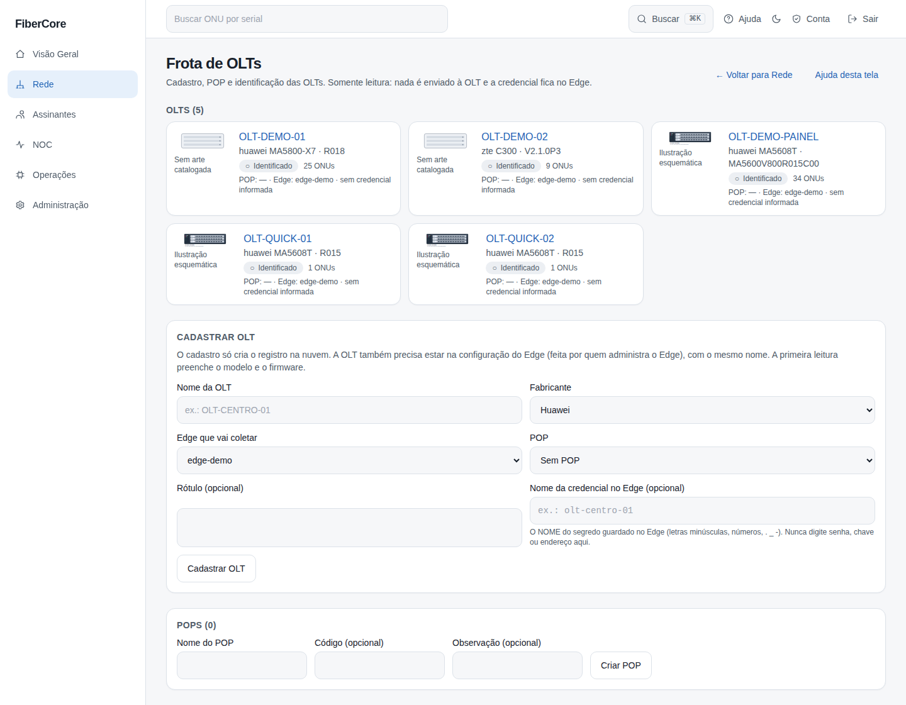
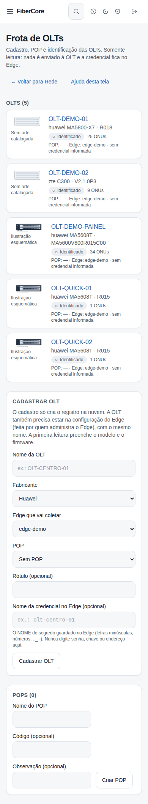
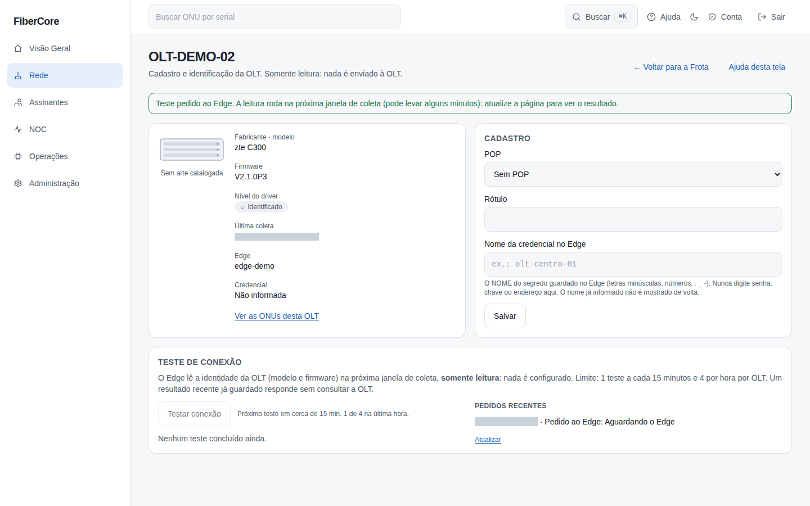
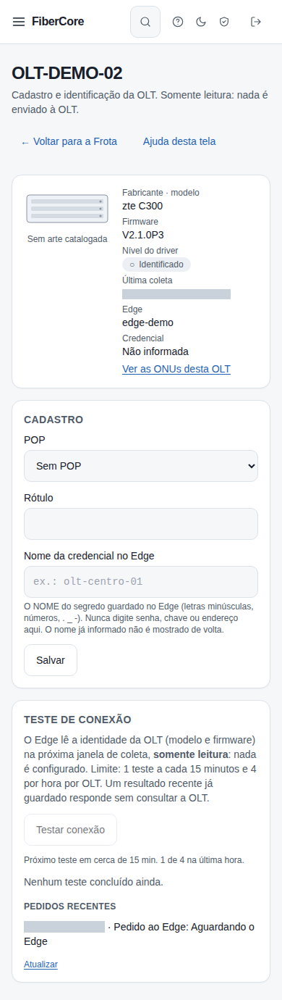

# Como cadastrar e acompanhar as OLTs (Frota de OLTs e POPs)

**Objetivo:** registrar uma OLT no FiberCore antes da primeira coleta, associá-la a um POP, e ver quais OLTs já foram lidas pelo Edge.

**Antes de começar:** o recurso **Frota de OLTs** precisa estar ligado para o provedor (flag `fleet_manager`). **Nada nesta tela envia comando à OLT, e a credencial da OLT nunca é digitada aqui:** ela fica guardada no Edge, e o cadastro guarda só o **nome** dela.

## Passo a passo

1. Em **Rede**, clique em **Frota de OLTs**. A lista mostra cada OLT com a miniatura do modelo (quando o catálogo de equipamentos está ligado), o fabricante, o modelo e o firmware lidos pelo Edge, o nível do driver, o POP e o Edge que a coleta. Uma OLT cadastrada que ainda não foi lida aparece como **Ainda não coletada** e com o modelo **ainda não lido**: nada é afirmado antes da leitura.
2. Para criar um **POP**, preencha o nome (e, se quiser, um código e uma observação) em **POPs** e clique em **Criar POP**. O nome é único, sem diferenciar maiúsculas de minúsculas.
3. Para **cadastrar uma OLT**, preencha o nome, escolha o fabricante, o Edge que vai coletá-la e, se quiser, o POP e um rótulo. No campo **Nome da credencial no Edge** informe **só o nome** do segredo guardado no Edge (letras minúsculas, números, `.`, `_` e `-`), nunca a senha, a chave nem o endereço da OLT. Valores que parecem endereço ou chave são recusados, e o valor recusado não volta na tela.
4. **Passo de quem administra o Edge:** a OLT também precisa estar na configuração do Edge, com o **mesmo nome**. Na primeira coleta o Edge preenche modelo, firmware e nível; o POP, o rótulo e o nome da credencial cadastrados são mantidos.
5. Para editar, clique no nome da OLT, altere o POP ou o rótulo (deixar um deles vazio o limpa) e clique em **Salvar**. **O nome da credencial já informado nunca é mostrado de volta** (a tela só diz “Informada”): para trocá-lo, digite o novo nome em **Substituir o nome da credencial no Edge**; para tirá-lo, marque **Remover o nome da credencial**; deixando o campo vazio, ele continua como está. O nome da OLT e o Edge dono não mudam por aqui.

6. **Teste de conexão:** no detalhe da OLT, o cartão **Teste de conexão** tem o botão **Testar conexão**. Ele **pede ao Edge** que leia a identidade da OLT (modelo, firmware, patch e tempo ligada, a mesma leitura somente leitura da versão) na **próxima janela de coleta**, que pode levar alguns minutos: o pedido aparece em **Pedidos recentes** como **Aguardando o Edge** e a identidade aparece depois de **Atualizar**. O resultado mostra se a identidade **confere** ou **diverge** da que a coleta já tinha; o fabricante é o do cadastro (a leitura não o informa). **Limite por OLT: 1 teste a cada 15 minutos e 4 por hora**; dentro do limite o botão fica desligado e a tela diz quando o próximo é permitido. Se já houver uma identidade recente guardada, ela responde na hora e **nenhuma consulta é feita à OLT** (isso não gasta o limite).

*Capturas reais da tela com dados sintéticos.*

## Resultado esperado

- A OLT cadastrada aparece na lista com **Ainda não coletada** até o Edge lê-la; depois mostra modelo, firmware, nível e quantidade de ONUs.
- Nenhuma tela, resposta ou registro de auditoria traz senha, chave ou endereço de OLT.
- Não existe exclusão de OLT por esta tela.
- O teste de conexão nunca configura nada na OLT: é só a leitura da versão, dentro do limite de 1 por 15 minutos e 4 por hora por OLT.

## Se algo não funcionar

- **O atalho “Frota de OLTs” não aparece:** o recurso está desligado para o provedor ou seu papel não tem permissão.
- **“Já existe uma OLT (ou POP) com esse nome”:** os nomes são únicos por provedor.
- **“Algum campo está fora do formato”:** confira o nome (2 a 60 caracteres) e o nome da credencial (só o nome do segredo, em minúsculas).
- **“Limite de testes atingido”:** espere o tempo indicado no cartão (1 teste a cada 15 minutos, 4 por hora por OLT). Não adianta insistir: o servidor recusa.
- **O teste fica “Aguardando o Edge”:** o Edge só roda a leitura na janela de coleta; se passar de uns 20 minutos, confirme com quem administra o Edge que ele está enviando sinal e que a OLT está configurada nele (inclusive o identificador que a nuvem conhece).
- **“Diverge da identidade que a coleta já tinha”:** o cadastro ou a configuração do Edge podem estar apontando para outra OLT; confira o nome e o Edge.
- **A OLT continua “Ainda não coletada”:** confirme com quem administra o Edge que a OLT está na configuração dele com o mesmo nome e que o Edge está enviando sinal.

## Evidências de documentação

- Build/commit: árvore de trabalho do PR2 parte A (ADR-0041)
- Browser/viewport: Chromium; desktop 1440×900 e mobile 390×844
- Caso de teste E2E: help-screenshots.spec.ts › rede/frota-de-olts; frota.spec.ts
- Dados: fictícios (seed `scripts/seed_demo.py`); sem informações reais de equipamentos ou clientes
