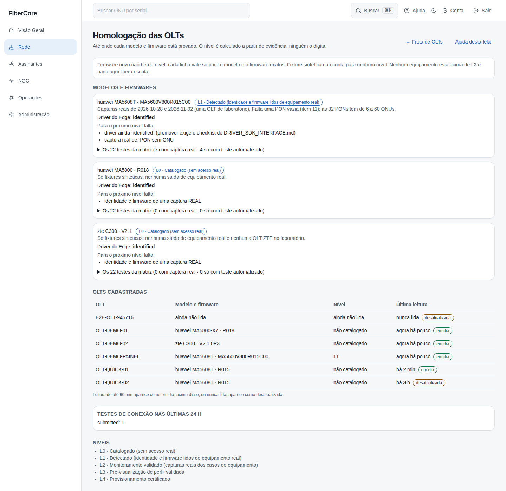
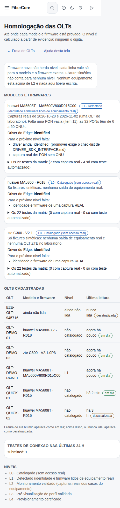

# Como ver até onde cada modelo de OLT está homologado

**Objetivo:** saber, para cada modelo e firmware de OLT, até que ponto o FiberCore comprovou que lê e interpreta o equipamento, e quais OLTs cadastradas estão com leitura em dia.

**Antes de começar:** o recurso **Frota de OLTs** precisa estar ligado para o provedor (flag `fleet_manager`). **A tela só lê:** nada aqui envia comando a uma OLT nem libera escrita.

## Passo a passo

1. Em **Frota de OLTs**, clique em **Homologação**.
2. Em **Modelos e firmwares**, cada cartão mostra o **nível**, o nível do driver no Edge e o que **falta para o próximo nível**. O nível é **calculado** a partir de evidência (capturas reais com impressão digital SHA-256 e testes automatizados); ninguém o digita. **L0** é só catalogado, **L1** é identidade e firmware lidos de um equipamento real, **L2** é monitoramento validado (driver promovido e capturas **reais** de placa, PON sem ONU, ONU online e offline e pager; um teste automatizado prova o nosso código, não o equipamento, e só vale para o caso de saída truncada), **L3** e **L4** exigem certificações registradas, que ainda não existem.
3. Abra **Os 22 testes da matriz** para ver, caso a caso, se há **captura real**, **teste automatizado**, **fixture sintética** ou **nenhuma evidência**. A fixture sintética aparece como “não conta”: ela ajuda a escrever o parser, mas não prova nada sobre o equipamento.
4. Em **OLTs cadastradas**, veja o nível de cada OLT e a idade da última leitura. Uma leitura de até 60 minutos aparece como **em dia**; acima disso, ou se a OLT nunca foi lida, aparece como **desatualizada**. Um modelo ou firmware que o livro não cita aparece como “não catalogado”: **firmware novo não herda o nível do anterior**.
5. O quadro **Testes de conexão nas últimas 24 h** soma os pedidos por resultado.

*Capturas reais da tela com dados sintéticos.*

## Resultado esperado

- Você sabe exatamente o que está provado e o que falta, por exemplo uma PON sem ONU na Huawei MA5608T.
- Nenhum equipamento aparece acima de L2.

## Erros comuns e como resolver

| Mensagem | O que significa |
|---|---|
| Página não encontrada | O recurso Frota de OLTs está desligado para o provedor |
| Sem permissão | Seu papel não permite ver a frota de OLTs |
| “O livro de evidências falhou na verificação” | Um arquivo de evidência quebrou uma regra de segurança e foi recusado inteiro; avise a engenharia |
| “desatualizada” | O Edge não leu a OLT na última hora; veja o estado do Edge e da OLT |

## Fontes e limites

- Capturas reais de equipamento vêm de uma única OLT de laboratório (Huawei MA5608T). ZTE C300 e Huawei MA5800 só têm fixtures sintéticas.
- Promover um modelo exige o checklist completo do driver e nova revisão; esta tela apenas mostra o resultado.
