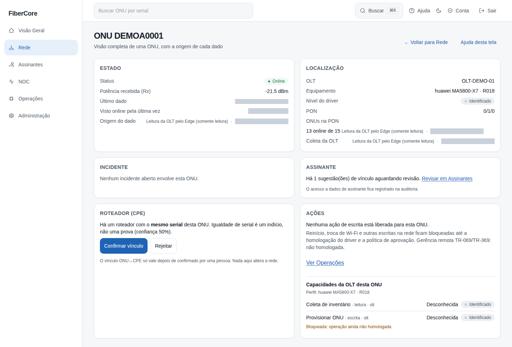
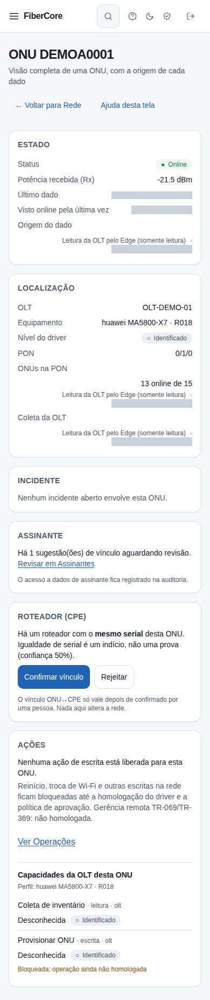

# Como ver a ONU 360

**Objetivo:** reunir em uma tela tudo o que se sabe de uma ONU — estado, sinal, onde ela está, se participa de um incidente e (para quem pode) a quem pertence — sempre com a origem e a idade de cada dado.

**Antes de começar:** Permissão `inventory:read`. O bloco **Assinante** só aparece para quem também tem `customers:read` (rota própria, dado pessoal); cada visualização é registrada na auditoria. O bloco **Incidente** exige `incidents:read`.

## Passo a passo

1. Acesse **Rede** e encontre a ONU (busque pelo serial, se preciso).
2. Clique no **serial**: abre um resumo no painel lateral. **Esc** ou **Fechar** volta para a lista.
3. No painel, clique em **Abrir ONU 360**.
4. Leia os blocos (cada dado externo mostra a **fonte**, a **idade** e se está **Atualizado** ou **defasado**): **Estado** (status, Rx, idade do dado, origem), **Localização** (OLT, PON, quantas ONUs da PON estão online), **Incidente**, **Assinante**, **Roteador (CPE)** (quando o recurso está ligado para o provedor) e **Ações**. Em **Ações**, a lista **Capacidades da OLT desta ONU** mostra, para o perfil da OLT (fabricante, modelo e firmware), o que se sabe de cada operação: **Suportada / Não suportada / Desconhecida** e o nível de evidência (**Identificado / Observado / Certificado**).

## Resultado esperado

Um painel por assunto, com texto e símbolo no status (a cor não é o único indicador). **Dados defasados** indicam o último estado conhecido, não uma queda confirmada.

## Permissões necessárias

`inventory:read` para a página; `customers:read` para o bloco **Assinante**; `incidents:read` para o bloco **Incidente**.

## Como ler o bloco Roteador (CPE)
- A ONU é vista pela OLT e o roteador pelo GenieACS: são fontes diferentes. Quando o serial é igual, o sistema só **sugere** o vínculo (confiança 50%): igualdade de serial é um indício, não uma prova.
- Quem tem `associations:review` vê **Confirmar vínculo** e **Rejeitar**. Só depois de confirmado aparecem fabricante, modelo, firmware e protocolo de gerência (TR-069/TR-369), com a origem e a idade do dado. Rejeitar fecha a sugestão e ela não volta.
- **Ambíguo:** o mesmo serial existe em mais de uma OLT; a confirmação fica bloqueada até o inventário ser corrigido.
- Uma ONU e um roteador só podem ter **um** vínculo confirmado. Nada neste bloco altera a rede.

## Como ler as capacidades
- **Desconhecida + Identificado** é o padrão: ainda não há evidência registrada para aquele perfil. **Isso não significa “suportada”.**
- Operações de **escrita** aparecem com “Bloqueada: operação ainda não homologada”. Nem uma capacidade marcada como Certificada libera a escrita sozinha: quem decide é o motor de operações.
- “Perfil incompleto” = a OLT ainda não informou fabricante, modelo ou firmware; nada pode ser confirmado.

## Se algo não funcionar

- **Página não encontrada:** a ONU não existe neste provedor ou o endereço está incorreto; volte para **Rede**.
- **Sem bloco Assinante:** seu papel não tem `customers:read`. Com a permissão, o bloco mostra se a ONU ainda não foi vinculada (revise em **Assinantes**).
- **“Seu papel não permite ver incidentes”:** falta `incidents:read`; isso não significa que não haja incidente.
- **“Não foi possível carregar as capacidades”:** falha momentânea; não significa que sejam suportadas. Recarregue.
- **Sem bloco Roteador (CPE):** o recurso está desligado para o seu provedor (liberação feita pelo responsável da plataforma).
- **Ações bloqueadas:** é esperado. Escrita na rede só é liberada após homologação do driver e política de aprovação; veja **Operações**.
