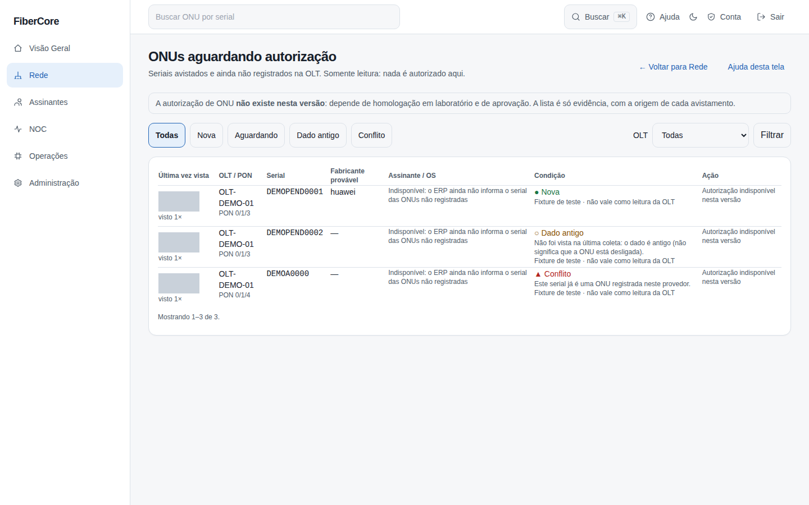
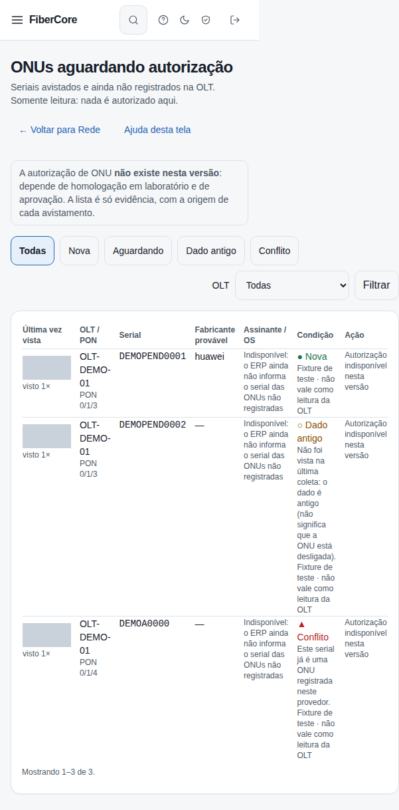

# Como ver as ONUs aguardando autorização

**Objetivo:** saber quais seriais de ONU a OLT avistou e que ainda não estão registrados, de onde veio cada informação e se há algo estranho (serial já registrado, serial em dois lugares, dado antigo). É **somente leitura**.

**Antes de começar:** o recurso **ONUs pendentes** ligado para o provedor e permissão (administrador, engenheiro e NOC N2 veem; administrador e engenheiro registram à mão). Sem o recurso ligado, a tela e o atalho não existem.

## Passo a passo

1. Acesse **Rede** e clique em **ONUs pendentes**.
2. Use os filtros **Nova**, **Aguardando**, **Dado antigo** e **Conflito**, ou escolha uma OLT.
3. Leia a **condição** de cada linha e os motivos abaixo dela:
   - **Nova:** vista pela primeira vez nas últimas 24 horas.
   - **Aguardando:** vista há mais de 24 horas e ainda presente na última coleta.
   - **Dado antigo:** não foi vista na última hora. Isso **não** quer dizer que a ONU está desligada: só que o dado envelheceu.
   - **Conflito:** o serial já é uma ONU registrada neste provedor ou apareceu em outra OLT/PON. A identidade não é certa; nada deve ser feito com ela.
4. Confira a **origem**: **Lida da OLT pelo Edge** vale como a palavra da OLT; **Registrada à mão** e **Fixture de teste** mostram “não vale como leitura da OLT” e **nunca** renovam o que a OLT informou.
5. Para trazer a **palavra da OLT**, escolha a OLT e clique em **Atualizar a partir da última leitura do Edge**. Isso usa a lista de ONUs detectadas que o Edge já leu (a consulta “ONTs detectadas e não confirmadas”, de até 1 hora): não pergunta nada à OLT e não autoriza nada. Sem leitura, o aviso pede a consulta em **Consultas da OLT**. Uma ONU que a leitura nova não lista não é apagada nem dada como autorizada: ela só envelhece para **Dado antigo**.
6. Para registrar um avistamento à mão, escolha a OLT, abra **Registrar avistamentos à mão** e escreva uma ONU por linha: PON, serial e, se quiser, o fabricante. Exemplo: `0/1/3 ABCD12345678 huawei`.

*Capturas reais com dados sintéticos (OLT de demonstração).*

## Resultado esperado

- A coluna **Assinante / OS** diz **Indisponível**: o ERP ainda não informa o serial de ONUs que não estão registradas. O sistema não adivinha o assinante.
- Em **Ação** aparece **Autorização indisponível nesta versão**. Autorizar ONU exige homologação em laboratório, aprovação e verificação antes/depois (ADR-0040); nada aqui altera a OLT.

## Se algo não funcionar

- **“Nenhuma ONU na fila”:** a lista é preenchida pela leitura da OLT ou por avistamentos registrados à mão. Com uma OLT escolhida, a linha **Última leitura do Edge** diz a idade da leitura e quantas ONUs ela listou; **sem leitura recente, uma fila vazia não prova que não há ONUs aguardando**.
- **“Linhas inválidas”:** use `PON SERIAL [fabricante]`, uma por linha, com PON como `0/1/3` e serial de 4 a 32 letras/números.
- **Conflito inesperado:** confira o serial no inventário da Rede; se a ONU mudou de lugar, a leitura mais recente da OLT é a que vale.
