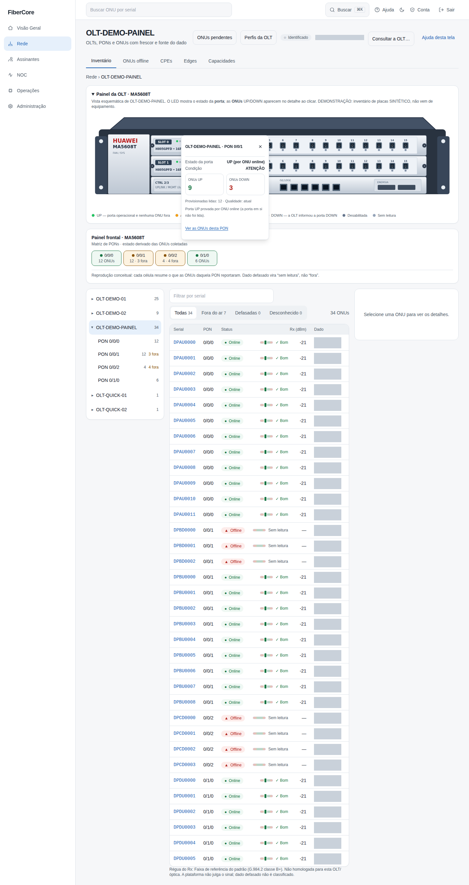
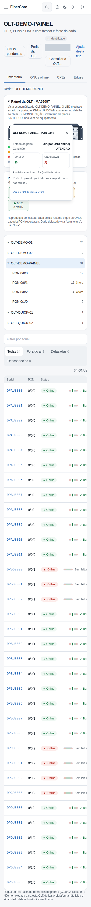

# Como ler o painel da OLT Huawei MA5608T (cartões, PONs e ONUs)

**Objetivo:** ver, de relance, os cartões GPON da OLT e o estado de cada PON, e abrir o detalhe de uma PON (ONUs UP e DOWN) sem sair da tela.

**Antes de começar:** a tela **Rede** com a OLT selecionada. O painel só aparece para OLT Huawei **MA5608T**; as outras OLTs continuam com a matriz de PONs de sempre. Ele é uma **vista esquemática**: não consulta a OLT e não envia nenhum comando.

## Passo a passo

1. Em **Rede**, escolha a OLT. Acima da matriz de PONs aparece **Painel da OLT · MA5608T** (clique no título para recolher).
2. Cada **cartão** mostra o slot (0 ou 1), o modelo da placa e as PONs numeradas. Os números são os da OLT (**F/S/P**, por exemplo `0/1/13` = frame 0, slot 1, porta 13). Só se desenham 16 PONs quando o modelo da placa lido do inventário diz 16 (placa GPFD); modelo desconhecido aparece como “cartão sem template”, e inventário não lido aparece como “não é slot vazio”.
3. Leia o **LED** de cada PON (a legenda fica embaixo do painel):
   - **verde (UP):** a porta está operacional e nenhuma ONU lida está fora;
   - **âmbar (ATENÇÃO):** há ONU(s) fora. A porta pode estar UP: PON UP com ONUs fora **não** vira DOWN;
   - **vermelho (DOWN):** a OLT informou a porta DOWN (leitura da porta);
   - **cinza escuro (desabilitada)** e **cinza claro (sem leitura):** nada é afirmado.
4. Clique (ou use Tab e Enter) numa PON: abre um **popover pequeno** com o **estado da porta**, a **condição**, as **ONUs UP** e **DOWN**, as provisionadas lidas e a qualidade da leitura. O link **Ver as ONUs desta PON** filtra a lista. Esc, o botão × ou um clique fora fecham.

*Capturas reais com dados sintéticos (OLT de demonstração; o inventário de placas é sintético).*

## Resultado esperado

- Os cartões e as PONs batem com o inventário confirmado; PON sem leitura fica cinza, nunca vermelha por presunção.
- O estado da **porta** e o estado das **ONUs** aparecem separados. Hoje a porta só é afirmada **UP** quando há uma ONU online nela (isso prova a porta); **DOWN** só aparece se a OLT informar a porta DOWN, o que depende de uma leitura de estado de porta ainda não homologada.
- Dado de ONU velho ou parcial vira “sem leitura” e a contagem mostra “—”, nunca zero.

## Se algo não funcionar

- **“Inventário de placas ainda não lido”:** peça a consulta **Placas e estado** em Rede → Consultas da OLT (leitura somente leitura). Sem ela, o cartão fica desconhecido (não vazio).
- **“Cartão sem template validado”:** o modelo da placa não é GPON de 16 portas conhecido (por exemplo, XG-PON ou DSL); o painel não inventa portas.
- **LED âmbar com “todas as ONUs fora”:** pode ser a PON; o estado da porta não foi lido. Confira na OLT por quem tem autorização.
- **Dados desatualizados:** o aviso no topo do painel diz; aguarde a próxima coleta do Edge.
