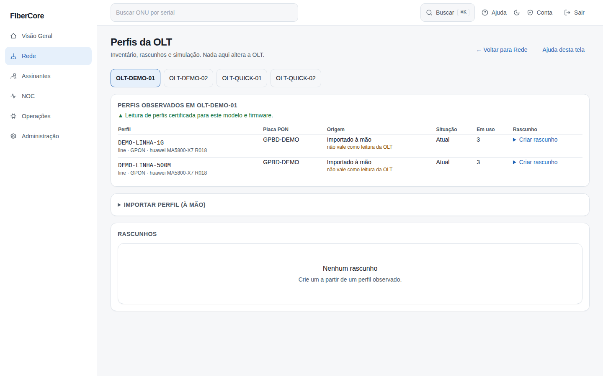
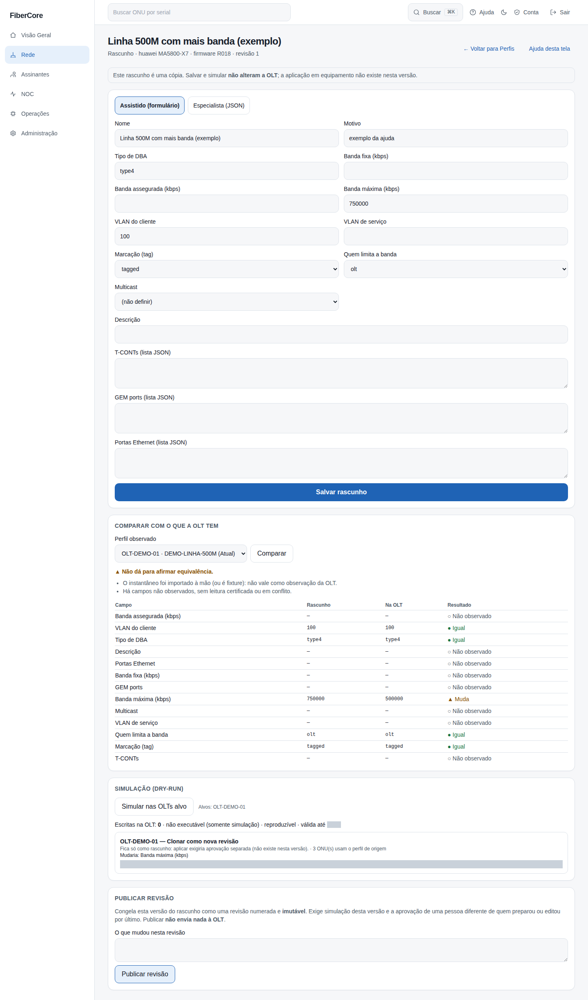
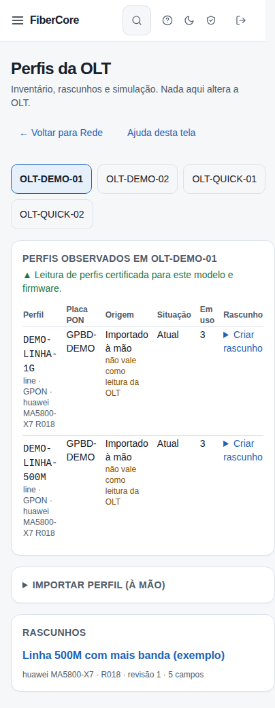
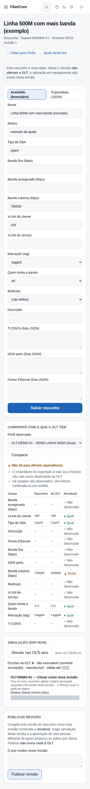

# Como ver, copiar, editar e simular perfis da OLT

**Objetivo:** conferir os perfis que a OLT usa (banda, VLAN, T-CONT, GEM), preparar uma cópia editável e **simular** o que aconteceria em cada OLT, sem alterar nada no equipamento.

**Antes de começar:** o recurso **Profile Studio** ligado para o provedor e permissão (administrador, engenheiro ou NOC N2 veem; administrador e engenheiro importam e editam). Sem o recurso ligado, a tela e o atalho **Perfis da OLT** não existem.

## Passo a passo

1. Acesse **Rede** e clique em **Perfis da OLT** (ou abra `/rede/perfis`). Escolha a OLT.
2. Leia a faixa de certificação: se a leitura de perfis **não** está certificada para o modelo e o firmware, as comparações aparecem como **“sem leitura certificada”**. Isso é proposital: o sistema não finge saber o que não confirmou.
3. Na lista, confira a **origem** de cada perfil. **Importado à mão** e **fixture** mostram o aviso “não vale como leitura da OLT”.
4. Para trazer um perfil, abra **Importar perfil (à mão)**, preencha o nome na OLT, a placa PON e os campos em JSON tipado e importe. Comandos de CLI e segredos são recusados. O instantâneo é **imutável**.
5. Em **Criar rascunho**, dê um nome e o motivo. O rascunho é uma **cópia**; o perfil original nunca muda.
6. Edite no modo **Assistido** (formulário por campo) ou **Especialista** (JSON tipado). Ao salvar, se outra pessoa salvou antes, o sistema recusa e pede para recarregar: nada é sobrescrito.
7. Em **Comparar com o que a OLT tem**, escolha o perfil observado. A tabela mostra, campo a campo: **Igual**, **Muda**, **Acrescenta**, **Remove**, **Não observado**, **Sem leitura certificada** ou **Conflito**.
8. Clique em **Simular nas OLTs alvo**. Cada OLT recebe uma estratégia (reutilizar, adotar a referência, clonar como nova revisão, planejar migração ou **bloqueado**) e a lista do que mudaria.

*Capturas reais com dados sintéticos (OLT de demonstração).*

### Publicar uma revisão (opcional)

Quando o rascunho está pronto e **foi simulado nesta versão**, uma pessoa com a permissão de publicar (administrador) escreve o que mudou e clica em **Publicar revisão**. A revisão fica numerada e **imutável**: para mudar, faça outro rascunho. Quem preparou ou editou por último o rascunho **não pode** aprová-lo; peça a outra pessoa. Publicar **não envia nada à OLT**.

## Resultado esperado

- A simulação mostra **Escritas na OLT: 0**, **não executável** e **reproduzível** (recalcular com as mesmas entradas dá o mesmo plano).
- Cada plano tem um identificador (hash) que uma futura aprovação ficaria presa a ele; o plano **expira** em minutos.
- **Não existe botão de aplicar** nesta versão. Aplicar em equipamento exige homologação em laboratório, autorização e verificação antes/depois (ADR-0040).

## Se algo não funcionar

- **“Não dá para afirmar equivalência”:** leia os motivos listados (leitura não certificada, instantâneo importado à mão, defasado ou incompleto). Só leitura feita pelo Edge, completa e recente permite afirmar.
- **“Quem preparou ou editou por último este rascunho não pode aprová-lo”:** peça a outra pessoa com permissão de publicar. **“Simule … antes de publicar”:** rode a simulação nesta versão do rascunho (qualquer edição exige simular de novo).
- **“Outra pessoa salvou este rascunho antes”:** recarregue a página e refaça a edição.
- **“Não salvei: algum campo não cabe no modelo tipado”:** confira faixas (VLAN 1–4094), listas e que não haja campo de comando.
- **“A OLT ainda não tem fabricante, modelo e firmware identificados”:** aguarde a coleta identificar a OLT.
- **Alvo “fora do escopo”:** a OLT é de outro fabricante, modelo ou firmware que o rascunho; ela é bloqueada e nunca comparada.
