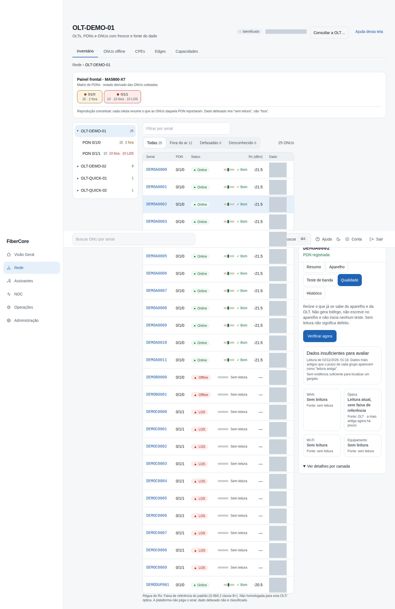
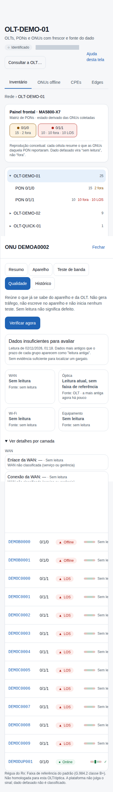
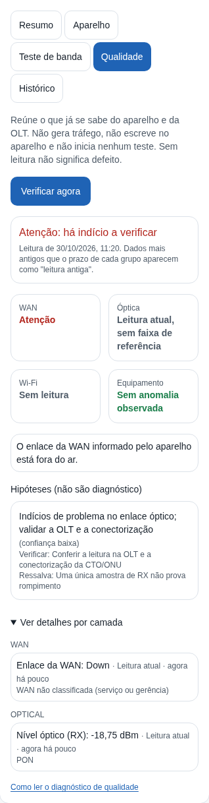
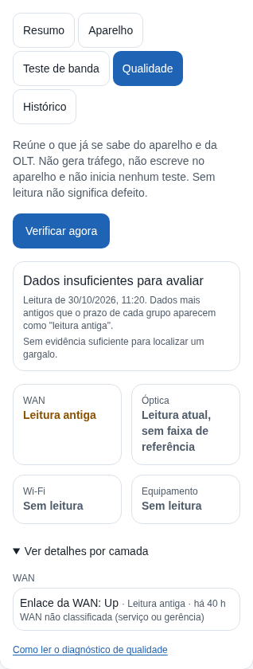

# Como ler o diagnóstico de qualidade do serviço

**Objetivo:** ver, em uma tela, o que o produto já sabe da ONT e do enlace óptico (WAN, óptica, Wi‑Fi e equipamento), com a idade de cada dado, e saber o que verificar em seguida.

**Antes de começar:** a leitura **só consulta dados que o produto já tem** (o último estado trazido do aparelho pelo ACS e o estado da ONU na OLT). Ela **não gera tráfego, não escreve no aparelho e não inicia nenhum teste**, e por isso não substitui o **Teste de banda**. A aba só existe quando o recurso está ligado para o provedor e há roteador vinculado e confirmado à ONU. Pedir a leitura exige a permissão `diagnostics:quality_run`; ver o histórico exige `diagnostics:quality_read`.

## Passo a passo

1. Acesse **Rede**, clique no serial da ONU (o painel abre ao lado da lista) e abra a aba **Qualidade**. Na **Visão 360°** use o botão **Diagnóstico**: a qualidade fica só na página de Diagnóstico, não há cartão dela na 360°.
2. Clique em **Verificar agora**. A tela mostra a leitura mais recente, com o horário em que foi feita.
3. Leia o **estado geral** (um de três): **Atenção: há indício a verificar**, **Nenhuma anomalia observada nos dados atuais** ou **Dados insuficientes para avaliar**. Esta tela nunca diz "tudo OK": no melhor caso, diz que nada anormal foi observado nos dados que existem.
4. Veja os quatro indicadores: **WAN**, **Óptica**, **Wi‑Fi** e **Equipamento**. Cada um diz *Sem anomalia observada*, *Atenção*, *Leitura antiga* ou *Sem leitura*.
5. Se houver **Hipóteses**, leia a ressalva e a verificação recomendada de cada uma. **Hipótese não é diagnóstico**: ela diz onde olhar primeiro, não o que está quebrado.
6. Abra **Ver detalhes por camada** para ver cada medida com valor, origem (escopo), estado e idade.

As duas telas acima são **reais** (aplicação integrada, dados sintéticos): o aparelho de demonstração não tem leitura do ACS, por isso a tela mostra **Sem leitura** e **Dados insuficientes**, nunca zero. As duas imagens seguintes são **cenários de teste**: a resposta do servidor foi simulada no navegador para mostrar estados que não existem no ambiente de demonstração. Nada nelas é medição de equipamento real.

## Resultado esperado

- **Sem leitura** (traço "—") significa que o dado não existe ou o aparelho não o informou; **não é zero e não é defeito**.
- **Leitura antiga** é história: o dado passou do prazo do seu grupo (WAN e equipamento 15 min, óptica 20 min, Wi‑Fi 5 min). Não entra na conta de anomalia nem de "sem anomalia".
- **WAN não classificada:** o ACS informa qual objeto de WAN respondeu, mas não se é a WAN de serviço do assinante ou a de gerência. A tela mostra o dado, mas **não o vende como medida da conexão do assinante**.
- **Óptica:** o nível vem da **OLT**. Sem o perfil homologado da classe de ONU, a tela mostra **"Leitura atual, sem faixa de referência"**: o valor aparece, mas não é julgado como bom ou ruim.
- **Hipóteses** só aparecem quando há evidência mínima atual; hoje as que dependem de ping, DNS, Ethernet ou Wi‑Fi detalhado **ficam inativas** (esses dados ainda não são coletados).

## Permissões necessárias

`diagnostics:quality_read` (ver) e `diagnostics:quality_run` (pedir a leitura rápida): isp_admin, engineer, noc_n2 e noc_n1. A leitura **completa** (`diagnostics:quality_run_full`, que referencia um teste de banda recente) existe só na API e não é oferecida nesta tela.

## Se algo não funcionar

- **A aba não aparece:** o recurso está desligado para o provedor ou a ONU não tem roteador vinculado e confirmado.
- **O botão está desabilitado:** o seu papel não permite pedir a leitura; o texto ao lado diz isso.
- **Tudo "Sem leitura":** o ACS não trouxe estado recente deste aparelho. Isso é uma limitação de coleta, não um diagnóstico; avise quem administra o Edge se persistir.
- **Não conclua** "o cliente está bem" por um **Nenhuma anomalia observada**, nem "o cliente está mal" por uma hipótese. Para banda, use o **Teste de banda**.

## Evidências de documentação

- Build/commit: ramo `feat/qos001-ui` (PR B do QoS-001, ADR-0039)
- Browser/viewport: Chromium; desktop 1440×900 e mobile 390×844
- Origem: `desktop.png` e `mobile.png` são capturas REAIS da aplicação integrada (pilha efêmera de teste, API e banco reais, dados sintéticos); `cenario-*.png` são CENÁRIOS DE TESTE com a resposta do BFF simulada, rotulados como tal acima
- Não verificado: leitura sobre ONT real com dados do ACS atuais (o LAB está com o estado do aparelho de bancada desatualizado e o recurso desligado); ping, DNS e Ethernet não fazem parte desta entrega
