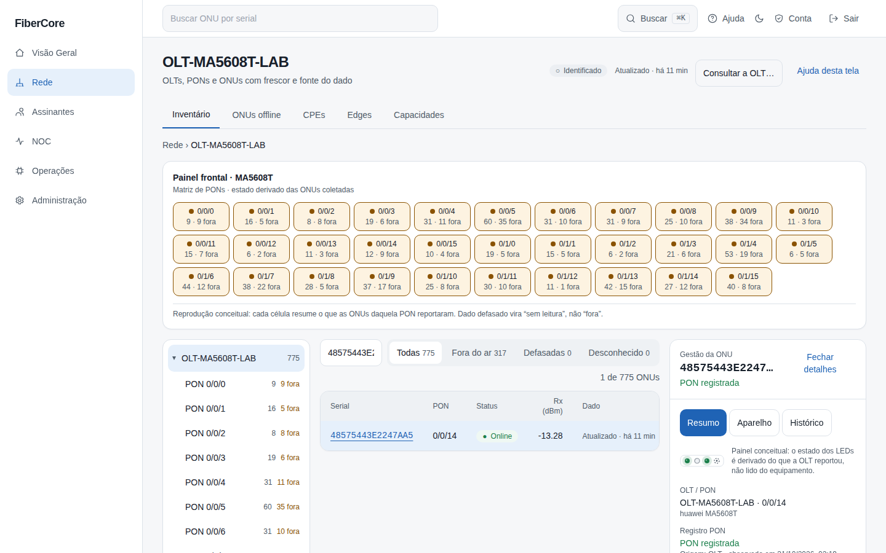
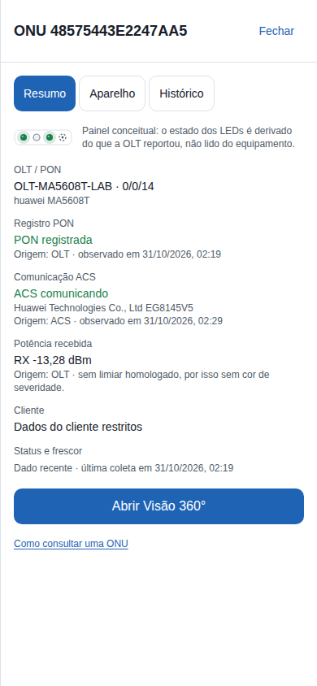

# Como ver o resumo rápido de uma ONU

**Objetivo:** com um clique na ONU da lista, ver qual ONU é, se ela está registrada na PON, se o ACS a vê, a potência recebida, a OLT/PON e o cliente (quando você pode ver), sabendo de onde vem e quão recente é cada dado.

**Antes de começar:** o recurso **Resumo rápido da ONU** precisa estar ligado para o provedor. Desligado, o clique abre o resumo simples de sempre.

## Passo a passo

1. Acesse **Rede** e clique no serial de uma ONU. O painel **Gestão da ONU** abre na coluna da direita; a lista continua visível ao lado (em telas estreitas vira uma gaveta).
2. Use as abas **Resumo**, **Aparelho** (só com roteador vinculado; veja “Como ver a configuração do aparelho”) e **Histórico** (30 dias). Setas, Home e End navegam pelas abas.
3. Clique em outra ONU para trocar: o painel mostra o carregamento e depois o resumo da nova ONU, nunca o da anterior. Mudar de PON ou de OLT limpa a seleção.
4. Leia **Registro PON** (vem da OLT) e **Comunicação ACS** (vem do roteador gerenciado): são fontes **separadas**.
5. Para ver tudo, clique em **Abrir Visão 360°**. Para fechar, **Fechar detalhes** ou **Esc**; o foco volta à ONU da lista.

## O que cada estado significa

| Texto | Significa |
|---|---|
| PON registrada / PON offline | A OLT viu a ONU assim na última coleta recente |
| PON: dados defasados | A última coleta é antiga: o painel mostra a última observação, **não** o estado atual |
| Estado PON desconhecido | Ainda não há leitura da OLT para esta ONU |
| ACS comunicando / sem contato recente | Só se a ONU tem roteador com vínculo confirmado. **Sem contato com o ACS não quer dizer ONU offline** |
| Sem roteador vinculado | Não há aparelho confirmado para ler no ACS |
| RX não disponível | Nenhuma medição de potência; não é 0 dBm |
| Dados do cliente restritos | Seu papel não permite ver o cliente |
| Vínculo de cliente sem confirmação | Há sugestão de cliente, mas ninguém confirmou: o nome não é mostrado |

A potência recebida não tem cor de alerta porque ainda não há limiar homologado. A miniatura é genérica; os pontos de luz mostram a PON e o ACS, não os LEDs reais.

## Se algo não funcionar

- **“Não foi possível carregar o resumo”:** clique em **Tentar novamente**; a lista continua funcionando.
- **O painel não abre assim:** o recurso está desligado para o provedor.

## Evidências de documentação

- Build/commit: be94359 (LAB, ramo principal após o PR 106)
- Browser/viewport: Chromium; desktop 1440×900 e mobile 390×844
- Origem: capturas REAIS do ambiente de laboratório com usuário de leitura (papel NOC N1), só a ONU de bancada (a lista foi filtrada pelo serial; a matriz e a árvore mostram apenas contagens); nenhuma ONU de cliente aparece
- Dados: ONU de bancada (Huawei EG8145V5); horários relativos mascarados na lista
