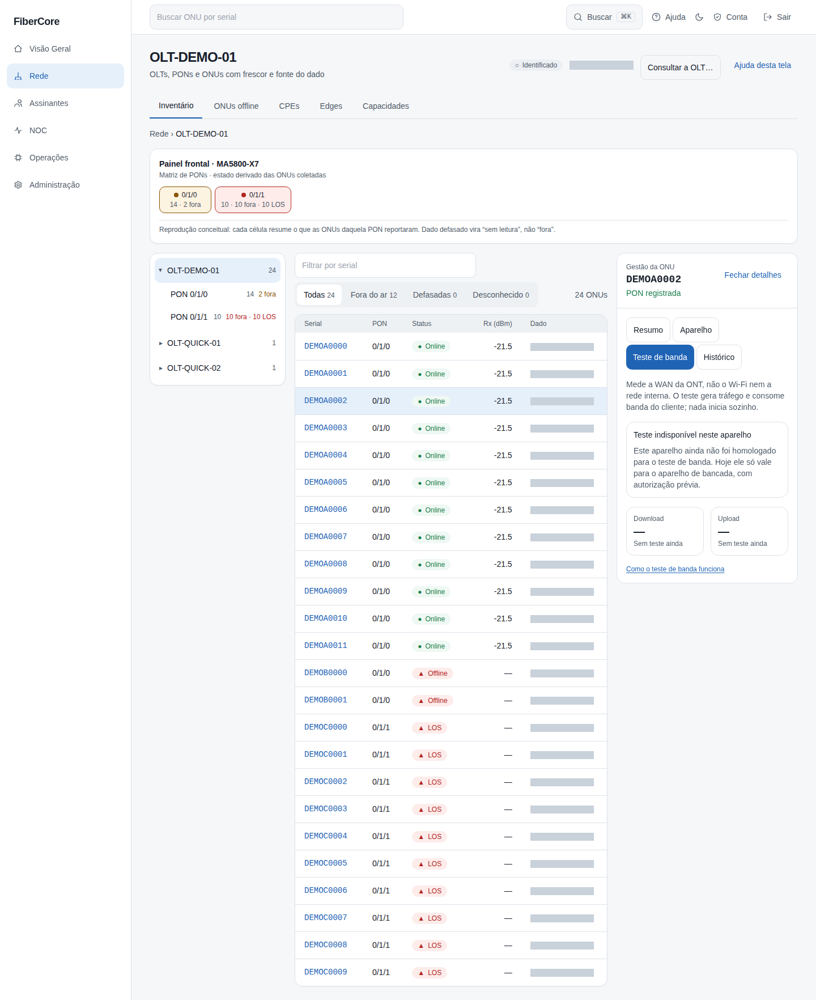
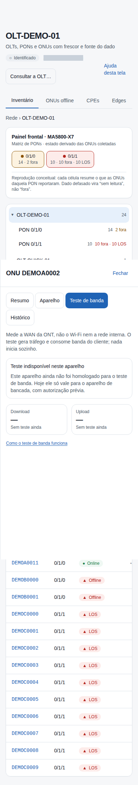
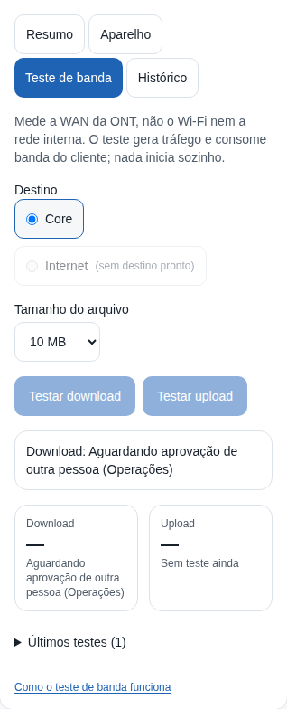
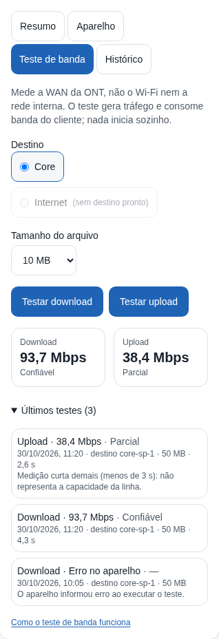

# Como testar a banda de uma ONT

**Objetivo:** medir a velocidade de download e de upload entre a ONT e um nó de teste do provedor (TR-143), e ler o resultado com a confiabilidade dele.

**Antes de começar:** o teste **gera tráfego na WAN do cliente** e consome banda. Ele mede a WAN da ONT, **não** o Wi‑Fi nem a rede interna. Nada inicia sozinho: uma pessoa com a permissão `diagnostics:speed_run` pede cada sentido, outra pessoa aprova, e hoje **só o aparelho de bancada, com autorização prévia do responsável, pode executar**. Para qualquer outro aparelho o teste aparece como indisponível, com o motivo. O recurso está desligado por padrão e só aparece quando o provedor o liga.

## Passo a passo

1. Acesse **Rede**, clique no serial da ONU (o painel abre ao lado da lista) e abra a aba **Teste de banda**. A aba só existe quando há roteador vinculado e confirmado à ONU. Na **Visão 360°** o mesmo conteúdo aparece no cartão **Teste de banda**.
2. Se aparecer **Teste indisponível neste aparelho**, leia o motivo abaixo da frase: ele diz o que falta (homologação do modelo e firmware, evidência de que o aparelho não segue redirecionamento, permissão do seu papel, vínculo ONU↔roteador). Nenhum botão de iniciar é mostrado nesse caso.
3. Se o teste está liberado, escolha o **Destino** (**Core** ou **Internet**; o que não tem nó pronto fica desabilitado) e o **Tamanho do arquivo** (10, 50 ou 200 MB). Clique em **Testar download** ou **Testar upload**. Só existe um teste por vez por aparelho, um por PON e dois por provedor.
4. O pedido fica **Aguardando aprovação de outra pessoa (Operações)**. Depois da aprovação o Edge executa, e a tela passa a **Em teste** e então ao resultado. A tela se atualiza sozinha enquanto há teste em andamento.
5. Leia o resultado: o valor em **Mbps** e a confiabilidade (**Confiável**, **Parcial** ou **Inconclusivo**). Abra **Últimos testes** para ver horário, destino, tamanho, duração e o motivo quando não é confiável.

As duas telas acima são **reais** (aplicação integrada, dados sintéticos): o aparelho de demonstração não é de bancada, por isso o teste está indisponível. As duas imagens seguintes são **cenários de teste**: a resposta do servidor foi simulada no navegador para mostrar os estados que só existem depois da homologação em equipamento e com um nó de teste. **Não são medições reais.**

## Resultado esperado

- **Confiável:** o aparelho concluiu, mediu por 3 s ou mais e transferiu praticamente todo o arquivo. O valor é calculado pelo servidor a partir dos contadores do aparelho.
- **Parcial:** o valor existe, mas a medição foi curta demais (menos de 3 s) ou transferiu menos do que o tamanho escolhido. Não represente a capacidade da linha.
- **Inconclusivo, Erro no aparelho, Falhou:** **não há número** (a tela mostra “—”, nunca 0). O motivo aparece em palavras.
- **Resultado incerto:** o Edge não conseguiu confirmar o que aconteceu (por exemplo, sem resposta no prazo). O aparelho de bancada fica **travado** até uma pessoa responsável conferir; nada é repetido automaticamente.

## Permissões necessárias

`diagnostics:speed_run` para pedir (isp_admin, engineer, noc_n2); `inventory:read` para ver; `jobs:approve` para aprovar, por **outra** pessoa; e a autorização prévia de uso único do responsável pela bancada (`bench:authorize`).

## Se algo não funcionar

- **Teste indisponível:** é o estado normal fora da bancada. O texto informa o motivo; não há como contornar pela tela.
- **Sem destino de teste pronto:** nenhum nó foi cadastrado ou o Edge não conseguiu verificá-lo nos últimos 30 minutos. Quem administra o Edge confere o nó e a saída da rede.
- **Já existe um teste em andamento:** aguarde; o limite protege a PON e o aparelho.
- **Aguardando aprovação por muito tempo:** o pedido expira em cerca de 15 minutos sem executar.
- **Não conclua que o cliente tem pouca banda** por um resultado Parcial ou Inconclusivo.

## Evidências de documentação

- Build/commit: ramo `feat/speed-diagnostics-ux` (PR 3 do Speed Diagnostics, ADR-0038)
- Browser/viewport: Chromium; desktop 1440×900 e mobile 390×844
- Origem: `desktop.png` e `mobile.png` são capturas REAIS da aplicação integrada (pilha efêmera de teste, API e banco reais, dados sintéticos); `cenario-*.png` são CENÁRIOS DE TESTE com a resposta do BFF simulada, rotulados como tal acima
- Não verificado: nenhuma medição real em ONT; capturas do ambiente de laboratório dependem do deploy autorizado desta versão e da homologação (guia `docs/operations/SPEED_HOMOLOGACAO.md`)
