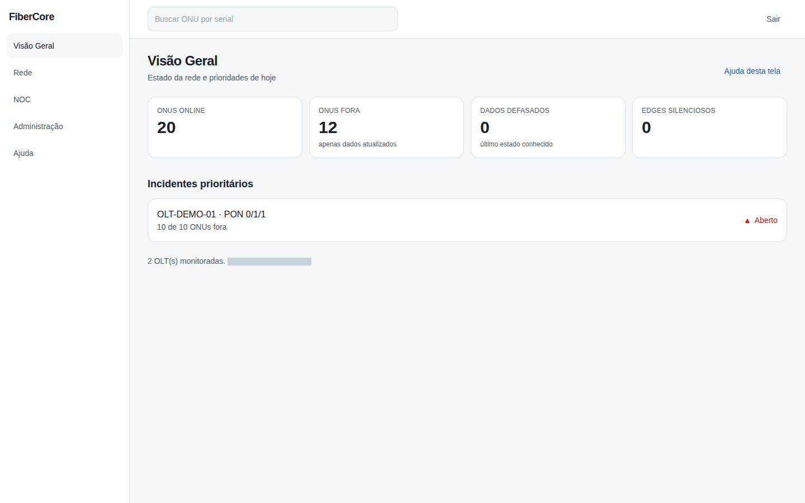
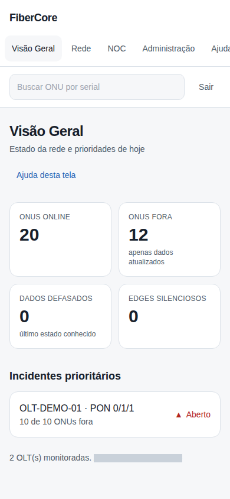

# Como ler a Visão Geral

**Objetivo:** entender em poucos segundos o estado da rede e o que merece atenção primeiro.

**Antes de começar:** Você precisa estar autenticado e ter acesso a um workspace. Papéis sem permissão de incidentes veem a mensagem **Sem permissão**.

## Passo a passo

1. Acesse **Visão Geral** no menu lateral.
2. Leia os quatro indicadores: **ONUs online**, **ONUs fora**, **Dados defasados** e **Edges silenciosos**.
3. Em **Incidentes prioritários**, selecione o incidente para abrir o NOC.
4. Use a caixa **Buscar ONU por serial** para ir direto à Rede.

## Resultado esperado

Os indicadores mostram apenas dados atualizados em **ONUs fora**; dados antigos aparecem em **Dados defasados** com o último estado conhecido.

## Permissões necessárias

`inventory:read`, `incidents:read`, `edge:read` (papéis isp_admin, engineer, noc_n2); noc_n1 e support veem parte dos indicadores.

## Se algo não funcionar

- **Dados defasados alto:** o Edge ou a OLT parou de enviar dados. Isso **não** significa que as ONUs estão offline.
- **Edges silenciosos > 0:** confira o heartbeat do Edge em Administração.
- **Sem permissão:** peça ao administrador do provedor o papel adequado.

## Evidências de documentação

- Build/commit: 1d9fb94 (árvore de trabalho do PR)
- Browser/viewport: Chromium; desktop 1440×900 e mobile 390×844
- Caso de teste E2E: help-screenshots.spec.ts › visao-geral/visao-geral
- Dados: fictícios (seed `scripts/seed_demo.py`); sem informações reais de clientes
